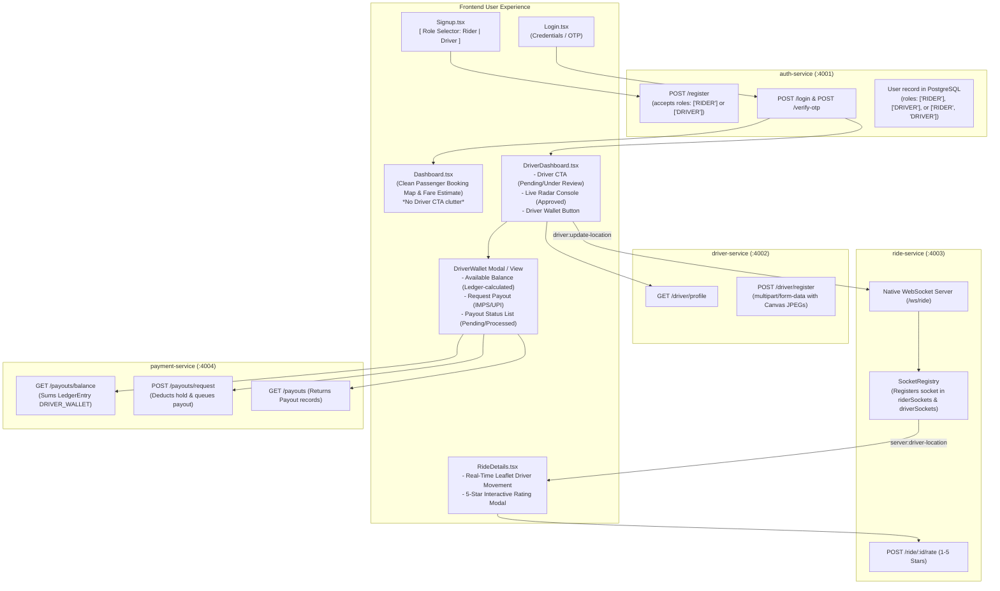
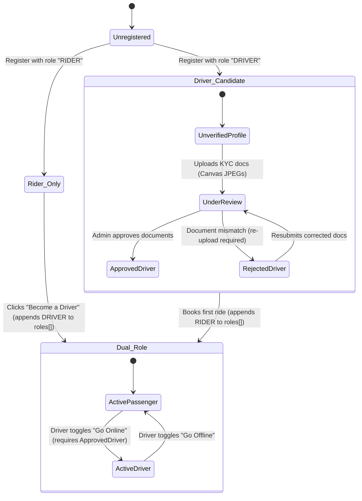
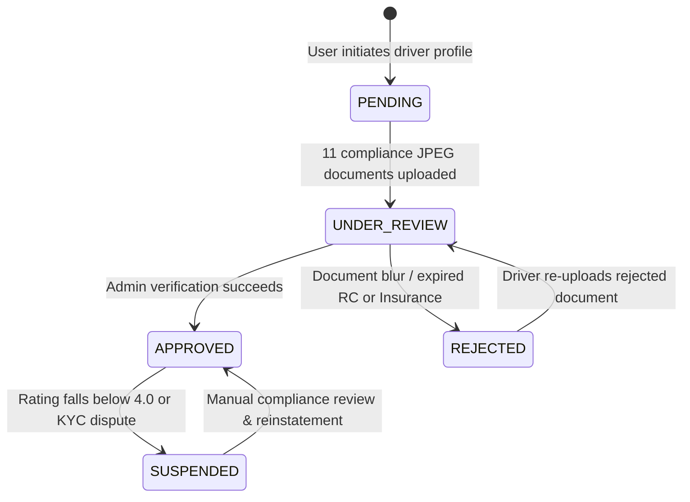
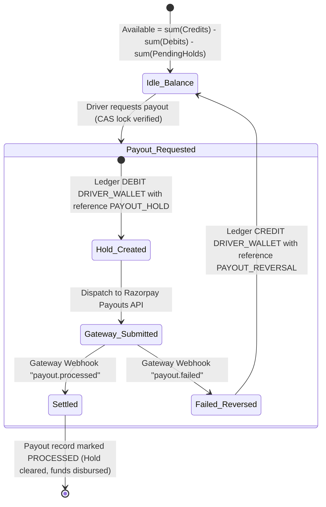
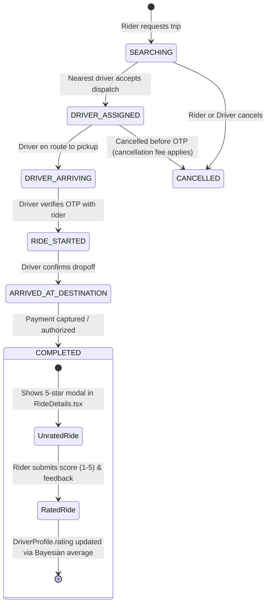
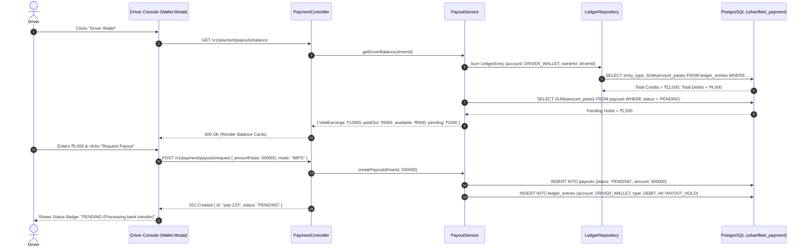
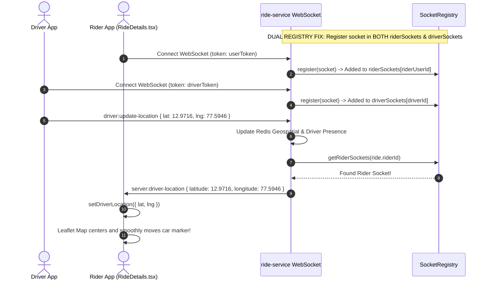
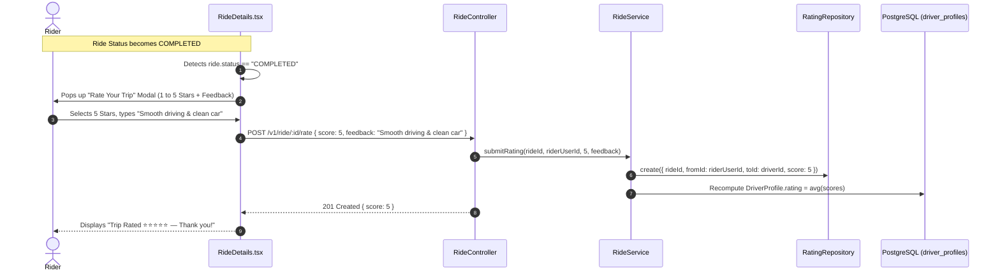
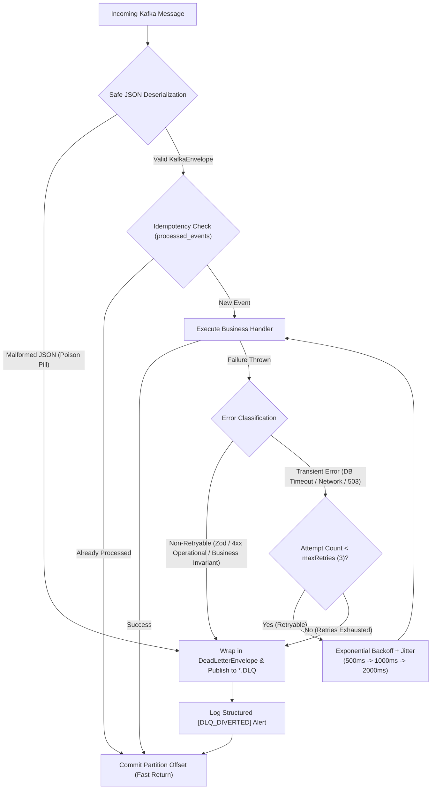

# Comprehensive Master Plan: Decoupled Rider & Driver Architecture

## 1. Executive Summary & Architectural Vision

This master blueprint delivers a fully decoupled, production-grade architecture for UrbanFleet with **Single Email Multi-Role Liberty**, **Ledger-backed Driver Wallets**, **Rider Ratings**, and **Real-Time WebSocket Movement**:

1. **Role Selection on Existing `Signup.tsx`**:
   - Passengers and Driver candidates register on `Signup.tsx` using an interactive role selector: **"I want to Ride"** (`RIDER`) vs **"I want to Drive"** (`DRIVER`).
   - The user registration flow, email verification link, OTP authentication, and password hashing remain identical.
   - A single email can hold both roles (`roles: ['RIDER', 'DRIVER']`), allowing drivers to take rides and riders to upgrade to drive without creating a second account.

2. **Clean, Uncluttered Rider Dashboard (`Dashboard.tsx`)**:
   - Remove `<DriverCTA>` from `Dashboard.tsx`. Riders get a dedicated, premium travel experience focused on route planning, fare estimates, and booking.

3. **Decoupled Driver Verification Journey (`DriverDashboard.tsx`)**:
   - Move `<DriverCTA>` into `/driver-dashboard`:
     - **Unverified / Missing Profile**: Renders `<DriverCTA>` prompting them to complete registration (`/driver-registration`).
     - **Under Review / Rejected**: Renders `<DriverCTA>` displaying exact document review progress or rejection reason.
     - **Approved**: Renders the complete, real-time Driver Radar Console (shift toggle "Go Online", incoming dispatches, live radar).

4. **Ledger-Backed Driver Wallet & Payout System (`payment-service` & UI)**:
   - Driver wallet balance is **computed from the immutable double-entry ledger** (`account: DRIVER_WALLET`) on every request:
     $$\text{Available Balance} = \sum \text{Credits} - \sum \text{Debits} - \text{Pending Payout Holds}$$
   - Dedicated **Driver Wallet UI** in the Driver Console:
     - Shows Total Earnings, Paid Out, and Available Balance.
     - "Request Payout" modal with bank transfer mode (IMPS/UPI).
     - Live Payout Status feed (`PENDING` in amber, `PROCESSED` in emerald, `FAILED` in rose).

5. **Rider-Side Ride Rating Option (`ride-service` & `RideDetails.tsx`)**:
   - When a ride transitions to `COMPLETED`, `RideDetails.tsx` displays an interactive **5-Star Rating Card**:
     - Star rating selector ($1$ to $5$ stars) with feedback notes (*"Smooth driving"*, *"Clean car"*).
     - Submits to `POST /v1/ride/:id/rate` (which updates `DriverProfile.rating`).

6. **Real-Time Driver Movement & Location Tracking on Rider Map (`RideDetails.tsx`)**:
   - **Root Cause Identified**: In `socket.registry.ts`, dual-role users (`['RIDER', 'DRIVER']`) had their sockets registered solely in `driverSockets` and skipped `riderSockets`. Consequently, `emitDriverLocation(ride.riderId)` could not locate the rider's socket!
   - **Fix**: Register sockets simultaneously in `riderSockets` (by `userId`) and `driverSockets` (by `driverId`).
   - In `RideDetails.tsx`, real-time `server:driver-location` updates smoothly animate the car marker and center the Leaflet map.

7. **Cloudinary-Compatible Default Documents (`.jpeg` / `.jpg`) & Pre-Filled Form**:
   - Replace synthetic `.svg` mock blobs with genuine raster **`.jpeg` / `.jpg`** binaries generated via HTML5 Canvas (Cloudinary rejects `.svg`).
   - Form fields are pre-filled by default for instant, one-click end-to-end registration testing.

8. **Driver Ride History & Session Management**:
   - Driver Trip History (`/ride/history/driver`) showing completed trips, earnings breakdown per trip, and rider details.
   - Multi-device management via `/security-devices` protected by RFC 6819 anti-replay session versioning.

9. **Production-Grade Kafka Dead Letter Queue (DLQ) & Resilience Pipeline**:
   - Eliminates head-of-line blocking on Kafka partitions with an automated Retry-and-Divert Consumer Interceptor (`createResilientConsumer`).
   - Differentiates transient (5xx / network) vs terminal (4xx / Zod / poison pill) failures, executes exponential backoff with jitter, and routes terminal failures to standardized `*.DLQ` topics with full error envelopes (`DeadLetterEnvelope`).
   - Safely commits offsets upon DLQ diversion so downstream valid events process with zero latency.
   - Provides operational redrive/replay tooling (`scripts/replay-dlq.ts`) to reprocess DLQ messages after fixes.

---

## 2. Complete Database Schemas (All Microservices)

### 2.1 Auth Service Database (`urbanfleet_auth`)

```prisma
datasource db {
  provider = "postgresql"
}

generator client {
  provider = "prisma-client-js"
  output   = "../src/generated/client"
}

enum Role {
  RIDER
  DRIVER
}

enum OutboxStatus {
  PENDING
  PROCESSING
  PUBLISHED
  FAILED
}

model User {
  id              String        @id @default(uuid()) @db.Uuid
  email           String        @unique @db.VarChar(255)
  passwordHash    String        @map("password_hash") @db.VarChar(255)
  firstName       String        @map("first_name") @db.VarChar(50)
  lastName        String        @map("last_name") @db.VarChar(50)
  roles           Role[]        @default([RIDER])  // Supports ['RIDER'], ['DRIVER'], or ['RIDER', 'DRIVER']
  isEmailVerified Boolean       @default(false) @map("is_email_verified")
  avatarUrl       String?       @map("avatar_url") @db.VarChar(500)

  createdAt       DateTime      @default(now()) @map("created_at")
  updatedAt       DateTime      @updatedAt @map("updated_at")

  sessions        Session[]

  @@map("users")
}

model Session {
  id           String    @id @default(uuid()) @db.Uuid
  userId       String    @map("user_id") @db.Uuid
  user         User      @relation(fields: [userId], references: [id], onDelete: Cascade)
  version      Int       @default(1) // RFC 6819 Anti-Replay Session Version
  userAgent    String?   @map("user_agent") @db.VarChar(1000)
  ipAddress    String?   @map("ip_address") @db.VarChar(45)
  deviceType   String?   @map("device_type") @db.VarChar(50)
  browser      String?   @map("browser") @db.VarChar(100)
  os           String?   @map("os") @db.VarChar(100)
  lastActiveAt DateTime  @default(now()) @map("last_active_at")
  expiresAt    DateTime  @map("expires_at")
  createdAt    DateTime  @default(now()) @map("created_at")

  @@index([userId])
  @@map("sessions")
}

model OutboxEvent {
  id                String       @id @default(uuid()) @db.Uuid
  topic             String       @db.VarChar(100)
  partitionKey      String       @map("partition_key") @db.VarChar(100)
  eventType         String       @map("event_type") @db.VarChar(100)
  aggregateType     String       @map("aggregate_type") @db.VarChar(50)
  aggregateId       String       @map("aggregate_id") @db.VarChar(100)
  aggregateSequence Int          @default(1) @map("aggregate_sequence")
  payload           Json
  status            OutboxStatus @default(PENDING)
  retryCount        Int          @default(0) @map("retry_count")
  lastError         String?      @map("last_error")
  lockedAt          DateTime?    @map("locked_at")
  lockedBy          String?      @map("locked_by") @db.VarChar(100)
  leaseExpiresAt    DateTime?    @map("lease_expires_at")
  publishedAt       DateTime?    @map("published_at")
  createdAt         DateTime     @default(now()) @map("created_at")

  @@index([status, leaseExpiresAt, createdAt])
  @@index([partitionKey, aggregateSequence])
  @@map("outbox_events")
}

model ProcessedEvent {
  eventId       String   @map("event_id") @db.Uuid
  consumerGroup String   @map("consumer_group") @db.VarChar(100)
  processedAt   DateTime @default(now()) @map("processed_at")

  @@id([eventId, consumerGroup])
  @@map("processed_events")
}
```

---

### 2.2 Payment Service Database & Ledger (`urbanfleet_payment`)

```prisma
datasource db {
  provider = "postgresql"
}

generator client {
  provider = "prisma-client-js"
  output   = "../src/generated/client"
}

enum PaymentStatus {
  CREATED
  PENDING
  AUTHORIZED
  CAPTURED
  FAILED
  REFUNDED
  PARTIALLY_REFUNDED
  CANCELLED
}

enum PayoutStatus {
  PENDING
  SUBMITTED
  PROCESSED
  FAILED
  REVERSED
}

enum LedgerAccount {
  RIDER
  PLATFORM
  DRIVER
  BANK
  RIDER_WALLET
  DRIVER_WALLET
  PLATFORM_COMMISSION
  GATEWAY_CLEARING
  TAX_COLLECTED
}

enum LedgerEntryType {
  DEBIT
  CREDIT
}

model Payment {
  id                         String        @id @default(uuid()) @db.Uuid
  rideId                     String        @unique @map("ride_id") @db.Uuid
  riderId                    String        @map("rider_id") @db.Uuid
  driverId                   String?       @map("driver_id") @db.Uuid
  paymentSequence            Int           @default(1) @map("payment_sequence")
  gateway                    String        @default("RAZORPAY") @db.VarChar(50)
  gatewayOrderId             String?       @map("gateway_order_id") @db.VarChar(255)
  gatewayPaymentId           String?       @unique @map("gateway_payment_id") @db.VarChar(255)
  amountPaise                Int           @map("amount_paise")
  currency                   String        @default("INR") @db.VarChar(3)
  status                     PaymentStatus @default(PENDING)
  method                     String?       @db.VarChar(50)
  fareBreakdown              Json?         @map("fare_breakdown")
  idempotencyKey             String?       @unique @map("idempotency_key") @db.VarChar(255)
  attemptNumber              Int           @default(1) @map("attempt_number")
  failureReason              String?       @map("failure_reason")
  ledgerTransactionId        String?       @map("ledger_transaction_id") @db.VarChar(255)
  capturedAt                 DateTime?     @map("captured_at")
  createdAt                  DateTime      @default(now()) @map("created_at")
  updatedAt                  DateTime      @updatedAt @map("updated_at")

  payouts                    Payout[]
  refundRecords              Refund[]

  @@map("payments")
}

model Payout {
  id                          String       @id @default(uuid()) @db.Uuid
  driverId                    String       @map("driver_id") @db.Uuid
  paymentId                   String?      @map("payment_id") @db.Uuid
  payment                     Payment?     @relation(fields: [paymentId], references: [id], onDelete: SetNull)
  rideId                      String       @map("ride_id") @db.Uuid
  amountPaise                 Int          @map("amount_paise")
  currency                    String        @default("INR") @db.VarChar(3)
  status                      PayoutStatus @default(PENDING)
  mode                        String       @default("IMPS") @db.VarChar(20) // IMPS, UPI, NEFT
  gatewayPayoutId             String?      @unique @map("gateway_payout_id") @db.VarChar(255)
  utr                         String?      @db.VarChar(255)
  ledgerTransactionId         String?      @map("ledger_transaction_id") @db.VarChar(255)
  failureReason               String?      @map("failure_reason")
  processedAt                 DateTime?    @map("processed_at")
  failedAt                    DateTime?    @map("failed_at")
  createdAt                   DateTime     @default(now()) @map("created_at")
  updatedAt                   DateTime     @updatedAt @map("updated_at")

  @@index([driverId])
  @@index([rideId])
  @@map("payouts")
}

model LedgerEntry {
  id             String          @id @default(uuid()) @db.Uuid
  transactionId  String          @map("transaction_id") @db.Uuid
  account        LedgerAccount
  entryType      LedgerEntryType @map("entry_type")
  amountPaise    BigInt          @map("amount_paise")
  currency       String          @default("INR") @db.VarChar(3)
  ownerId        String?         @map("owner_id") @db.VarChar(255) // driverId or riderId
  referenceType  String          @map("reference_type") @db.VarChar(50) // RIDE_EARNING, PAYOUT_DEBIT, PLATFORM_FEE
  referenceId    String?         @map("reference_id") @db.VarChar(255)
  idempotencyKey String?         @map("idempotency_key") @db.VarChar(255)
  legIndex       Int?            @map("leg_index")
  description    String?
  createdAt      DateTime        @default(now()) @map("created_at")

  @@unique([idempotencyKey, legIndex])
  @@index([transactionId])
  @@index([account, ownerId])
  @@map("ledger_entries")
}
```

---

### 2.3 Driver Service Database (`urbanfleet_driver`)

```prisma
datasource db {
  provider = "postgresql"
}

generator client {
  provider = "prisma-client-js"
  output   = "../src/generated/client"
}

enum VerificationStatus {
  PENDING
  UNDER_REVIEW
  VERIFIED
  APPROVED
  REJECTED
  SUSPENDED
}

model DriverProfile {
  id                 String             @id @default(uuid()) @db.Uuid
  userId             String             @unique @map("user_id") @db.Uuid // FK to auth-service User.id
  licenseNumber      String             @unique @map("license_number") @db.VarChar(50)
  verificationStatus VerificationStatus @default(PENDING) @map("verification_status")
  isAvailable        Boolean            @default(false) @map("is_available")
  rating             Decimal            @default(5.0) @db.Decimal(3, 2)
  totalTrips         Int                @default(0) @map("total_trips")
  totalEarningsPaise BigInt             @default(0) @map("total_earnings_paise")
  profilePhoto       Json?              @map("profile_photo") // { url, publicId }
  isVerified         Boolean            @default(false) @map("is_verified")

  createdAt          DateTime           @default(now()) @map("created_at")
  updatedAt          DateTime           @updatedAt @map("updated_at")

  vehicles           Vehicle[]
  documents          Document[]

  @@map("driver_profiles")
}

model Vehicle {
  id              String        @id @default(uuid()) @db.Uuid
  driverProfileId String        @map("driver_profile_id") @db.Uuid
  driverProfile   DriverProfile @relation(fields: [driverProfileId], references: [id], onDelete: Cascade)
  make            String        @db.VarChar(50)
  model           String        @db.VarChar(50)
  year            Int
  plateNumber     String        @unique @map("plate_number") @db.VarChar(50)
  color           String        @db.VarChar(30)
  category        String        @default("SEDAN") @db.VarChar(20) // CAR, BIKE, AUTO, SEDAN, SUV
  isActive        Boolean       @default(true) @map("is_active")
  images          Json?         // { front, back, left, right, interior }

  createdAt       DateTime      @default(now()) @map("created_at")
  updatedAt       DateTime      @updatedAt @map("updated_at")

  @@index([driverProfileId])
  @@map("vehicles")
}

model Document {
  id              String             @id @default(uuid()) @db.Uuid
  driverProfileId String             @map("driver_profile_id") @db.Uuid
  driverProfile   DriverProfile      @relation(fields: [driverProfileId], references: [id], onDelete: Cascade)
  type            String             @db.VarChar(50) // DRIVING_LICENSE, REGISTRATION_CERTIFICATE, INSURANCE, POLLUTION
  documentUrl     String             @map("document_url") @db.VarChar(500)
  status          VerificationStatus @default(PENDING)
  expiresAt       DateTime?          @map("expires_at")
  rejectionReason String?            @map("rejection_reason")
  number          String?            @db.VarChar(100)
  frontImage      String?            @map("front_image") @db.VarChar(500)
  backImage       String?            @map("back_image") @db.VarChar(500)
  isVerified      Boolean            @default(false) @map("is_verified")

  createdAt       DateTime           @default(now()) @map("created_at")
  updatedAt       DateTime           @updatedAt @map("updated_at")

  @@index([driverProfileId])
  @@map("documents")
}
```

---

### 2.4 Ride Service Database (`urbanfleet_ride`)

```prisma
datasource db {
  provider = "postgresql"
}

generator client {
  provider = "prisma-client-js"
  output   = "../src/generated/client"
}

enum RideStatus {
  SEARCHING
  DRIVER_ASSIGNED
  DRIVER_ARRIVING
  RIDE_STARTED
  ARRIVED_AT_DESTINATION
  COMPLETED
  CANCELLED
}

enum RidePaymentStatus {
  PENDING
  PAID
  CAPTURED
  FAILED
  REFUNDED
}

model Ride {
  id                 String            @id @default(uuid()) @db.Uuid
  riderId            String            @map("rider_id") @db.Uuid // FK to User.id (Rider)
  driverId           String?           @map("driver_id") @db.Uuid // FK to DriverProfile.id (Driver)
  vehicleCategory    String            @default("SEDAN") @map("vehicle_category") @db.VarChar(20)

  status             RideStatus        @default(SEARCHING)
  paymentStatus      RidePaymentStatus @default(PENDING) @map("payment_status")
  rideSequence       Int               @default(1) @map("ride_sequence")

  pickupLat          Decimal           @default(0.0) @map("pickup_lat") @db.Decimal(10, 7)
  pickupLng          Decimal           @default(0.0) @map("pickup_lng") @db.Decimal(10, 7)
  pickupAddress      String            @default("") @map("pickup_address") @db.VarChar(255)

  destinationLat     Decimal           @default(0.0) @map("destination_lat") @db.Decimal(10, 7)
  destinationLng     Decimal           @default(0.0) @map("destination_lng") @db.Decimal(10, 7)
  destinationAddress String            @default("") @map("destination_address") @db.VarChar(255)

  distanceKm         Decimal           @default(0.0) @map("distance_km") @db.Decimal(6, 2)
  durationMinutes    Int               @default(0) @map("duration_minutes")

  baseFarePaise      Int               @default(0) @map("base_fare_paise")
  surgeMultiplier    Decimal           @default(1.0) @map("surge_multiplier") @db.Decimal(3, 2)
  totalFarePaise     Int               @default(0) @map("total_fare_paise")

  ratings            Rating[]

  createdAt          DateTime          @default(now()) @map("created_at")
  updatedAt          DateTime          @updatedAt @map("updated_at")

  @@index([riderId])
  @@index([driverId])
  @@index([status])
  @@map("rides")
}

model Rating {
  id        String   @id @default(uuid()) @db.Uuid
  rideId    String   @map("ride_id") @db.Uuid
  ride      Ride     @relation(fields: [rideId], references: [id], onDelete: Cascade)
  fromId    String   @map("from_id") @db.Uuid // Rider giving rating
  toId      String   @map("to_id") @db.Uuid   // Driver receiving rating
  score     Int      // 1 to 5 stars
  feedback  String?  @db.VarChar(500)
  createdAt DateTime @default(now()) @map("created_at")

  @@unique([rideId, fromId])
  @@index([toId])
  @@map("ratings")
}
```

---

### 2.5 Notification Service Database (`urbanfleet_notification`)

```prisma
datasource db {
  provider = "postgresql"
}

generator client {
  provider = "prisma-client-js"
  output   = "../src/generated/client"
}

enum NotificationChannel {
  EMAIL
  SMS
  PUSH
  IN_APP
}

enum NotificationStatus {
  PENDING
  DISPATCHED
  SENT
  DELIVERED
  FAILED
}

model NotificationRecord {
  id               String              @id @default(uuid()) @db.Uuid
  recipient        String              @db.VarChar(255)
  channel          NotificationChannel @default(EMAIL)
  template         String              @db.VarChar(100)
  idempotencyKey   String              @unique @map("idempotency_key") @db.VarChar(255)
  payload          Json
  status           NotificationStatus  @default(PENDING)
  retryCount       Int                 @default(0) @map("retry_count")
  lastError        String?             @map("last_error")
  gatewayMessageId String?             @map("gateway_message_id") @db.VarChar(255)

  dispatchedAt     DateTime?           @map("dispatched_at")
  createdAt        DateTime            @default(now()) @map("created_at")
  updatedAt        DateTime            @updatedAt @map("updated_at")

  @@index([status, createdAt])
  @@map("notification_records")
}

model ProcessedEvent {
  eventId       String   @map("event_id") @db.Uuid
  consumerGroup String   @map("consumer_group") @db.VarChar(100)
  processedAt   DateTime @default(now()) @map("processed_at")

  @@id([eventId, consumerGroup])
  @@map("processed_events")
}
```

---

### 2.6 Cross-Service Distributed Referential Integrity & Boundary Mapping

In our decoupled microservices architecture, physical database foreign keys (`REFERENCES`) cannot span distinct PostgreSQL schemas. Referential integrity is strictly maintained through **Aggregate Identity Anchors** and **Eventual Consistency Envelopes**:

| Domain Entity | Primary Schema Owner | Foreign Consumers (Logical FK) | Integrity & Sync Mechanism |
| :--- | :--- | :--- | :--- |
| `User.id` (UUID) | `urbanfleet_auth.users` | `driver_profiles.user_id`, `rides.rider_id`, `ledger_entries.owner_id` | Synchronized via `USER_REGISTERED` Kafka domain event. Identity immutable once created. |
| `DriverProfile.id` (UUID) | `urbanfleet_driver.driver_profiles` | `rides.driver_id`, `payouts.driver_id`, `ratings.to_id`, `ledger_entries.owner_id` | Synchronized via `DRIVER_VERIFIED` event. `ride-service` validates driver active status via Redis Geospatial presence. |
| `Ride.id` (UUID) | `urbanfleet_ride.rides` | `payments.ride_id`, `payouts.ride_id`, `ratings.ride_id`, `ledger_entries.reference_id` | Synchronized via `RIDE_COMPLETED` and `RIDE_CANCELLED` events via Transactional Outbox. |
| `Payment.id` (UUID) | `urbanfleet_payment.payments` | `payouts.payment_id`, `refunds.payment_id` | Managed within `payment-service` schema. `PAYMENT_CAPTURED` emitted to Kafka to trigger receipt notifications and driver wallet credits. |

---

## 3. High-Level System Architecture & Flowchart



---

### 3.2 Formal State Machine Models

#### 3.2.1 Multi-Role Identity & Account Authorization State Machine

A single authenticated entity (`User.id`) transitions through role states without requiring duplicate emails or credential fragmentation:



#### 3.2.2 Driver KYC & Verification Lifecycle State Machine



#### 3.2.3 Double-Entry Financial Payout & Escrow State Machine



#### 3.2.4 Ride Lifecycle with Real-Time Movement & Rating State Machine



---

## 4. Sequence Diagrams

### 4.1 Driver Wallet & Ledger-Calculated Payout Flow



#### 4.1.1 Double-Entry Conservation Proof & Accounting Legs

In `payment-service`, financial consistency is guaranteed by **Strict Double-Entry Bookkeeping**. Money cannot be created or destroyed: every economic transaction consists of at least two balanced legs where total debits equal total credits.

$$\sum_{i=1}^{k} \text{Debit}_i = \sum_{j=1}^{m} \text{Credit}_j \iff \sum_{\text{all legs}} \text{SignedAmount}_n \equiv 0$$

##### Complete Ledger Leg Journal:

| Event / Trigger | Leg Index | Account | Entry Type | Amount (Paise) | Reference Type | Description |
| :--- | :--- | :--- | :--- | :--- | :--- | :--- |
| **Ride Completed** | 0 | `GATEWAY_CLEARING` | `DEBIT` | Total Fare ($F$) | `RIDE_PAYMENT` | Gross receivable from Razorpay gateway |
| | 1 | `DRIVER_WALLET` | `CREDIT` | Driver Share ($E_d$) | `RIDE_EARNING` | Driver net earning attributed to driverId |
| | 2 | `PLATFORM_COMMISSION`| `CREDIT` | Platform Fee ($C_p$) | `PLATFORM_FEE` | UrbanFleet commission margin |
| **Payout Requested** | 0 | `DRIVER_WALLET` | `DEBIT` | Payout Amount ($P$) | `PAYOUT_HOLD` | Funds locked from available balance |
| | 1 | `BANK` | `CREDIT` | Payout Amount ($P$) | `PAYOUT_ESCROW` | Held in settlement clearing account |
| **Payout Settled** | 0 | `BANK` | `DEBIT` | Payout Amount ($P$) | `PAYOUT_SETTLED`| Disbursed via IMPS/UPI banking rails |
| | 1 | `PLATFORM` | `CREDIT` | Payout Amount ($P$) | `BANK_OUTFLOW` | Realized bank debit confirmation |
| **Payout Failed** | 0 | `BANK` | `DEBIT` | Payout Amount ($P$) | `PAYOUT_REVERSAL`| Reversal of escrow lock |
| | 1 | `DRIVER_WALLET` | `CREDIT` | Payout Amount ($P$) | `PAYOUT_REFUND` | Restored to driver's available wallet |

##### Atomic CAS Balance Calculation Formula:

When a driver opens the wallet or requests a payout, `payment-service` calculates:

$$\text{Gross Credits} = \sum_{\substack{e.\text{account} = \text{DRIVER\_WALLET} \\ e.\text{type} = \text{CREDIT}}} e.\text{amount}$$

$$\text{Realized Debits} = \sum_{\substack{e.\text{account} = \text{DRIVER\_WALLET} \\ e.\text{type} = \text{DEBIT}}} e.\text{amount}$$

$$\text{Pending Payout Holds} = \sum_{\substack{p.\text{status} = \text{'PENDING'} \\ p.\text{driverId} = \text{id}}} p.\text{amount}$$

$$\text{Net Available to Withdraw} = (\text{Gross Credits} - \text{Realized Debits}) - \text{Pending Payout Holds}$$

**Double-Spend Prevention**: Payout requests execute inside an isolated transaction with `SELECT ... FOR UPDATE` on the driver's latest payout sequence record. If $\text{Net Available} < \text{Requested Amount}$, the transaction aborts with `400 Bad Request: Insufficient balance`.

---

### 4.2 Real-Time Driver Movement on Rider Map (WebSocket Fix)



#### 4.2.1 Great Circle Navigation Mathematics & LERP Animation

To render realistic, smooth car movement without jitter between discrete 3-second GPS updates, the frontend applies **Spherical Forward Azimuth (Bearing)** and **Linear Interpolation (LERP)**:

##### 1. Forward Azimuth / Bearing Angle ($\theta$):
Calculates the exact compass orientation (in degrees from true north) so the vehicle marker rotates to face the direction of travel:

$$\Delta \lambda = \lambda_2 - \lambda_1$$

$$y = \sin(\Delta \lambda) \cdot \cos(\varphi_2)$$

$$x = \cos(\varphi_1) \cdot \sin(\varphi_2) - \sin(\varphi_1) \cdot \cos(\varphi_2) \cdot \cos(\Delta \lambda)$$

$$\theta = (\operatorname{atan2}(y, x) \cdot \frac{180}{\pi} + 360) \pmod{360}$$

*In Leaflet*: Rotates marker icon via CSS transform: `transform: rotate(${bearing}deg);`.

##### 2. 60 FPS Linear Interpolation (LERP):
Between successive GPS ticks at timestamp $t_0$ and $t_1$ over interval $\Delta t = t_1 - t_0$:

$$\mathbf{P}(t) = (1 - \alpha) \cdot \mathbf{P}_{\text{prev}} + \alpha \cdot \mathbf{P}_{\text{curr}}, \quad \text{where } \alpha = \min\left(1, \; \frac{t_{\text{current}} - t_0}{\Delta t}\right)$$

Driven via `requestAnimationFrame`, this transitions the Leaflet car marker smoothly across streets rather than jumping telepathically.

---

### 4.3 Rider-Side Ride Rating Flow



#### 4.3.1 Driver Rating Smoothing & Bayesian Formulation

Standard arithmetic averaging ($R = \frac{\sum r_i}{n}$) suffers from severe **cold-start volatility**: a newly approved driver who receives a single 1-star rating from an unreasonable rider immediately drops from 5.00 to 1.00, blocking them from dispatch queues.

UrbanFleet adopts the **Bayesian Smoothed Average Rating**:

$$\bar{R} = \frac{C \cdot m + \sum_{i=1}^{n} r_i}{C + n}$$

Where:
- $C = 10$: Prior confidence weight (equivalent to 10 baseline platform trips).
- $m = 4.85$: Global platform prior mean rating.
- $n$: Total ratings submitted for this driver.
- $\sum r_i$: Sum of all actual rider ratings.

**Properties**:
- For new drivers ($n=0$), rating safely defaults to $4.85$.
- As $n \to \infty$, the empirical mean dominates: $\lim_{n \to \infty} \bar{R} = \frac{1}{n} \sum r_i$.
- Prevents malicious outlier distortion while preserving long-term accountability.

---

## 5. Driver Ride History & Multi-Device Session Management

### 5.1 Driver Trip History (`/ride/history/driver`)
- **Backend**: `ride-service` already provides `GET /ride/history/driver` (`requireRole('DRIVER')`).
- **Endpoint Response**: Returns all completed, active, and cancelled trips where `driverId === user.driverId` or matches the authenticated driver's profile, including:
  - Fare breakdown (`baseFarePaise`, `driverEarningPaise`, `platformCommissionPaise`).
  - Pickup and destination addresses with timestamps.
  - Payment status (`PENDING`, `CAPTURED`, `REFUNDED`).
- **Frontend Integration (`RideHistory.tsx`)**:
  - `RideHistory.tsx` detects if the user is viewing in **Driver Mode** (via URL query `?mode=driver` or user role).
  - When in Driver Mode:
    - Calls `appApi.get("/ride/history/driver")`.
    - Renders **Driver Trip Journal**: Displays driver earnings in green (`+ ₹450`), trip duration, pickup/dropoff points, and rider name.
    - Provides filters: "All Trips", "Completed", "Cancelled".
- **Header Navigation in `DriverDashboard.tsx`**:
  - `<History />` button $\rightarrow$ navigates to `/history?mode=driver`.
  - `<Wallet />` button $\rightarrow$ opens Driver Wallet & Payout modal.
  - `<ShieldCheck />` button $\rightarrow$ navigates to `/security-devices`.
  - `<LogOut />` button $\rightarrow$ logs out the driver session.

---

## 6. Cloudinary-Compatible Default Documents (`.jpeg` / `.jpg`) & Pre-Filled Form

### 6.1 The Cloudinary SVG Incompatibility
- Currently, `createDefaultMockImage` generates mock files as `image/svg+xml`.
- **Cloudinary rejects SVG uploads** for identity avatars and driver KYC compliance documents (it expects raster binaries: `image/jpeg` or `image/png`).
- Uploading SVGs causes Cloudinary upload failures (`400 Bad Request: Unsupported format image/svg+xml`).

### 6.2 Solution: Canvas-Generated Binary JPEGs & Default Asset Bundle
1. **Dynamic HTML5 Canvas Binary JPEG Generator**:
   - Update `createDefaultMockImage(name: string, label: string)` in `DriverRegistration.tsx` to render onto an in-memory HTML5 `<canvas>` (with rich golden UrbanFleet stamp, title, document watermarks, and resolution 800x500).
   - Exports via `canvas.toBlob((blob) => new File([blob], name.replace('.svg', '.jpeg'), { type: "image/jpeg" }), "image/jpeg", 0.92)`.
   - Produces authentic binary JPEGs with standard magic bytes (`0xFF 0xD8 0xFF`), guaranteed 100% compatible with Cloudinary!
2. **Pre-Filled Form State**:
   - `DriverRegistration.tsx` initializes all fields by default so testing is instantaneous:
     - Vehicle Type: `CAR` (Toyota Innova Crysta, Pearl White, Plate `KA-01-MJ-5521`, Year `2023`).
     - License: `DL-1420110012345`, Expiry `2032-12-31`.
     - RC: `RC-KA01MJ5521-IND`.
     - Insurance: `POL-BAJAJ-8829102`, Expiry `2027-06-30`.
     - Pollution: Expiry `2026-12-31`.
     - Mock JPEGs pre-attached: `driver-profile.jpeg`, `license-front.jpeg`, `license-back.jpeg`, `vehicle-front.jpeg`, `vehicle-back.jpeg`, `vehicle-left.jpeg`, `vehicle-right.jpeg`, `vehicle-interior.jpeg`, `rc-certificate.jpeg`, `insurance-doc.jpeg`, `puc-doc.jpeg`.

---

## 7. Component-by-Component Modifications

### 7.1 `frontend/src/Signup.tsx`
- Add role selection toggle cards matching UrbanFleet parchment aesthetic:
  ```tsx
  <div className="grid grid-cols-2 gap-3 mb-4">
    <button
      type="button"
      onClick={() => setSelectedRole("RIDER")}
      className={`flex items-center justify-center gap-2 rounded-xl p-3 border text-sm font-semibold transition-all ${
        selectedRole === "RIDER"
          ? "border-[#b8722c] bg-[#fff4dc] text-[#3a1f0a] shadow-sm ring-1 ring-[#b8722c]"
          : "border-[#7a4416]/20 bg-[#fffaf0]/60 text-[#7a4416]/70 hover:bg-[#fffaf0]"
      }`}
    >
      <Navigation className="h-4 w-4" />
      Ride
    </button>
    <button
      type="button"
      onClick={() => setSelectedRole("DRIVER")}
      className={`flex items-center justify-center gap-2 rounded-xl p-3 border text-sm font-semibold transition-all ${
        selectedRole === "DRIVER"
          ? "border-[#b8722c] bg-[#fff4dc] text-[#3a1f0a] shadow-sm ring-1 ring-[#b8722c]"
          : "border-[#7a4416]/20 bg-[#fffaf0]/60 text-[#7a4416]/70 hover:bg-[#fff4dc]"
      }`}
    >
      <Car className="h-4 w-4" />
      Drive
    </button>
  </div>
  ```
- Send `roles: [selectedRole]` in `api.post("/register", { ... })`.

### 7.2 `frontend/src/Dashboard.tsx`
- Remove `<DriverCTA ... />` from the bottom of `Dashboard.tsx`.
- Riders enjoy a clean, distraction-free travel interface.

### 7.3 `frontend/src/DriverDashboard.tsx`
- When `!profile || !isApprovedDriver`:
  - Render the rich `<DriverCTA driver={profile} loading={loading} />` component.
- Add `<Wallet />` button in top bar opening the **Driver Wallet & Payouts** modal.
- Add `<History />` button navigating to `/history?mode=driver`.

### 7.4 `frontend/src/RideDetails.tsx`
- **Real-Time Map Animation**: Map center pans dynamically to `driverLocation` when received over WebSocket, and the car marker updates position smoothly.
- **5-Star Rating Modal**: Rendered when `ride.status === "COMPLETED"`, calling `POST /v1/ride/:id/rate`.

### 7.5 `services/ride-service/src/websocket/registry/socket.registry.ts`
- Fix socket registration: register socket in `riderSockets.get(userId)` AND in `driverSockets.get(driverId)` so location broadcasts reach dual-role users seamlessly.

### 7.6 `packages/contracts`
- Define `DeadLetterEnvelope<T>` and `DeadLetterEnvelopeSchema` in `src/envelopes/dead-letter-envelope.ts`.
- Export `DRIVER_DLQ` and `NOTIFICATION_DLQ` in `src/events/event-topics.ts`.
- Export new types from `src/index.ts`.

### 7.7 `packages/common`
- Create `src/kafka/resilient-consumer.ts`:
  - `createResilientConsumerRunner(config, handler)`:
    - Safe JSON deserialization guard for syntax error poison pills.
    - Exponential backoff + jitter retry loop for transient failures.
    - Error classifier (non-retryable operational 4xx vs transient 5xx).
    - Automated dead-letter routing to `${topic}.DLQ`.
    - Offset commitment upon successful DLQ routing to prevent partition head-of-line blocking.
  - Export from `src/index.ts`.

### 7.8 Microservice Consumers
- `services/payment-service/src/consumers/payment.consumer.ts`: Wire with `createResilientConsumerRunner`, targeting `EventTopics.RIDE_DLQ`.
- `services/ride-service/src/consumers/payment.consumer.ts`: Wire with `createResilientConsumerRunner`, targeting `EventTopics.PAYMENT_DLQ`.
- `services/driver-service/src/consumers/driver.consumer.ts`: Wire with `createResilientConsumerRunner`, targeting `EventTopics.AUTH_DLQ` and `EventTopics.RIDE_DLQ`.
- `services/notification-service/src/consumers/notification.consumer.ts`: Wire with `createResilientConsumerRunner`, targeting `EventTopics.AUTH_DLQ` and `EventTopics.PAYMENT_DLQ`.

---

### 7.9 Exhaustive REST & WebSocket API Contract Specifications

#### 7.9.1 Auth Service: `POST /v1/auth/register`
- **Purpose**: Creates an account with explicit initial role selection (`RIDER` vs `DRIVER`).
- **Request Headers**: `Content-Type: application/json`
- **Request Body**:
  ```json
  {
    "email": "sarah.driver@example.com",
    "password": "SecurePassword123!",
    "firstName": "Sarah",
    "lastName": "Connor",
    "roles": ["DRIVER"]
  }
  ```
- **Response `201 Created`**:
  ```json
  {
    "success": true,
    "user": {
      "id": "c7a8409e-f41e-436d-88b9-8bc3c8cf3519",
      "email": "sarah.driver@example.com",
      "firstName": "Sarah",
      "lastName": "Connor",
      "roles": ["DRIVER"],
      "isEmailVerified": false
    },
    "message": "Registration successful. Please verify your email via the link sent to your inbox."
  }
  ```

#### 7.9.2 Payment Service: `GET /v1/payment/payouts/balance`
- **Purpose**: Returns real-time driver wallet balance dynamically computed from double-entry ledger entries.
- **Request Headers**: `Authorization: Bearer <driver_jwt>`
- **Response `200 OK`**:
  ```json
  {
    "success": true,
    "balance": {
      "totalEarningsPaise": 2500000,
      "paidOutPaise": 1000000,
      "availablePaise": 1200000,
      "pendingPayoutsPaise": 300000,
      "currency": "INR"
    }
  }
  ```

#### 7.9.3 Payment Service: `POST /v1/payment/payouts/request`
- **Purpose**: Queues an atomic driver payout request, locking available balance via `PAYOUT_HOLD`.
- **Request Headers**: `Authorization: Bearer <driver_jwt>`, `Idempotency-Key: <uuid>`
- **Request Body**:
  ```json
  {
    "amountPaise": 500000,
    "mode": "IMPS",
    "beneficiary": {
      "accountNumber": "919876543210",
      "ifsc": "HDFC0001234",
      "name": "Sarah Connor"
    }
  }
  ```
- **Response `201 Created`**:
  ```json
  {
    "success": true,
    "payout": {
      "id": "e43b1234-88aa-419b-90f1-02a8b9193290",
      "driverId": "c7a8409e-f41e-436d-88b9-8bc3c8cf3519",
      "amountPaise": 500000,
      "status": "PENDING",
      "mode": "IMPS",
      "currency": "INR",
      "createdAt": "2026-10-25T04:25:00.000Z"
    }
  }
  ```
- **Error `400 Bad Request`**:
  ```json
  {
    "success": false,
    "error": {
      "code": "INSUFFICIENT_BALANCE",
      "message": "Requested payout (₹5,000.00) exceeds available balance (₹1,200.00)"
    }
  }
  ```

#### 7.9.4 Ride Service: `POST /v1/ride/:id/rate`
- **Purpose**: Authenticated rider submits a 1-to-5 star rating with structured feedback tags for a completed trip.
- **Request Headers**: `Authorization: Bearer <rider_jwt>`
- **Request Body**:
  ```json
  {
    "score": 5,
    "feedback": "Smooth driving and punctual arrival",
    "tags": ["POLITE_DRIVER", "CLEAN_CAR", "SMOOTH_RIDE"]
  }
  ```
- **Response `201 Created`**:
  ```json
  {
    "success": true,
    "rating": {
      "id": "b90932a1-3312-4c6e-8219-918237912831",
      "rideId": "f101349a-5521-419a-bc01-198273918273",
      "score": 5,
      "feedback": "Smooth driving and punctual arrival",
      "createdAt": "2026-10-25T04:25:30.000Z"
    }
  }
  ```

#### 7.9.5 Ride Service: `GET /v1/ride/history/driver`
- **Purpose**: Returns paginated completed and cancelled rides for the authenticated driver with financial breakdown.
- **Request Headers**: `Authorization: Bearer <driver_jwt>`
- **Response `200 OK`**:
  ```json
  {
    "success": true,
    "rides": [
      {
        "id": "f101349a-5521-419a-bc01-198273918273",
        "status": "COMPLETED",
        "paymentStatus": "CAPTURED",
        "pickupAddress": "Indiranagar 100ft Rd, Bengaluru",
        "destinationAddress": "Koramangala 5th Block, Bengaluru",
        "distanceKm": 6.8,
        "durationMinutes": 24,
        "fareBreakdown": {
          "totalFarePaise": 45000,
          "driverEarningPaise": 36000,
          "platformCommissionPaise": 9000
        },
        "completedAt": "2026-10-25T03:50:00.000Z"
      }
    ],
    "pagination": { "page": 1, "limit": 20, "total": 42 }
  }
  ```

#### 7.9.6 Native WebSocket Real-Time Location Frames (`/ws/ride`)
- **Driver Location Emission (`driver:update-location`)**:
  ```json
  {
    "event": "driver:update-location",
    "payload": {
      "latitude": 12.9715987,
      "longitude": 77.5945627,
      "heading": 184.5,
      "speedKmph": 34.2
    }
  }
  ```
- **Rider Location Broadcast (`server:driver-location`)**:
  ```json
  {
    "event": "server:driver-location",
    "payload": {
      "rideId": "f101349a-5521-419a-bc01-198273918273",
      "driverId": "c7a8409e-f41e-436d-88b9-8bc3c8cf3519",
      "latitude": 12.9715987,
      "longitude": 77.5945627,
      "bearing": 184.5,
      "timestamp": "2026-10-25T04:26:00.124Z"
    }
  }
  ```

---

## 8. Production-Grade Kafka Dead Letter Queue (DLQ) Architecture & Resilience Pipeline

### 8.1 The Core Problem in Current Setup: Head-of-Line Blocking vs. Silent Swallow
In distributed streaming architectures with Apache Kafka, message delivery is strictly ordered per partition key. 
Currently, UrbanFleet's Kafka consumers face two critical failure modes:
1. **The Poison Pill Head-of-Line Block**: If a consumer throws an unhandled error (e.g., malformed payload or unhandled 500), KafkaJS pauses and retries repeatedly. Because the message offset is never committed, **the entire partition halts**. All subsequent rides, payments, or notifications assigned to that partition are blocked indefinitely.
2. **The Silent Swallow**: In consumers where errors are wrapped in a generic `try { ... } catch (err) { logger.error(...) }` without re-throwing (e.g., `ride-service/payment.consumer.ts`), Kafka commits the offset as if the event succeeded. The event is lost forever with zero recovery trail.
3. **The "Phantom DLQ"**: Topics `urbanfleet.*.events.DLQ` were provisioned in `kafka-init.sh`, but no consumer was wired to produce to them or recover from them.

### 8.2 The Solution: The "Retry-and-Dead-Letter Interceptor" Architecture
We implement an enterprise-grade Resilient Consumer Framework in `@urbanfleet/common` (`createResilientConsumerRunner`):



### 8.3 Standardized DLQ Schema & Envelopes (`packages/contracts`)

#### `DeadLetterEnvelope<T>` Schema
```typescript
export interface DeadLetterEnvelope<T = unknown> {
  id: string;                      // Unique DLQ event UUID
  originalEventId?: string;        // ID from source KafkaEnvelope if present
  originalTopic: string;           // E.g. 'urbanfleet.ride.events'
  originalPartition: number;       // Partition index where message was received
  originalOffset: string;          // Consumer offset of the failed message
  originalKey?: string;            // Partition key (e.g. rideId, userId)
  consumerGroup: string;           // E.g. 'payment-service-group'
  serviceName: string;             // E.g. 'payment-service'
  failedAt: string;                // ISO 8601 timestamp of terminal failure
  retryCount: number;              // Total retry attempts made before dead-lettering
  error: {
    name: string;                  // E.g. 'ZodError', 'PrismaClientKnownRequestError'
    message: string;               // Clear error message
    stack?: string;                // Full stack trace for root cause debugging
    isOperational?: boolean;       // Operational error flag
    statusCode?: number;           // HTTP status code if applicable (e.g. 400, 422)
  };
  payload: T;                      // The original parsed payload
  rawPayload?: string;             // Raw buffer/string if JSON deserialization failed
}
```

#### Updated Topic Catalog (`packages/contracts/src/events/event-topics.ts`)
```typescript
export const EventTopics = {
  // Primary Domain Event Topics
  AUTH_EVENTS: 'urbanfleet.auth.events',
  DRIVER_EVENTS: 'urbanfleet.driver.events',
  RIDE_EVENTS: 'urbanfleet.ride.events',
  PAYMENT_EVENTS: 'urbanfleet.payment.events',
  NOTIFICATION_EVENTS: 'urbanfleet.notification.events',
  
  // Dedicated Dead Letter Queue (DLQ) Topics
  AUTH_DLQ: 'urbanfleet.auth.events.DLQ',
  DRIVER_DLQ: 'urbanfleet.driver.events.DLQ',
  RIDE_DLQ: 'urbanfleet.ride.events.DLQ',
  PAYMENT_DLQ: 'urbanfleet.payment.events.DLQ',
  NOTIFICATION_DLQ: 'urbanfleet.notification.events.DLQ',
} as const;
```

### 8.4 The Resilient Consumer Wrapper Implementation (`packages/common/src/kafka/resilient-consumer.ts`)
A higher-order wrapper wrapping `consumer.run({ eachMessage })`:

```typescript
export interface ResilientConsumerConfig {
  kafka: Kafka;
  consumer: Consumer;
  consumerGroup: string;
  serviceName: string;
  maxRetries?: number;             // Default: 3
  initialBackoffMs?: number;       // Default: 500ms
  backoffMultiplier?: number;      // Default: 2
  maxBackoffMs?: number;           // Default: 5000ms
}

export function createResilientConsumerRunner(
  config: ResilientConsumerConfig,
  handler: (envelope: KafkaEnvelope<unknown>, rawPayload: Record<string, unknown>) => Promise<void>
) {
  const dlqProducer = config.kafka.producer();
  let dlqProducerConnected = false;

  const getDlqProducer = async () => {
    if (!dlqProducerConnected) {
      await dlqProducer.connect();
      dlqProducerConnected = true;
    }
    return dlqProducer;
  };

  const routeToDlq = async (params: {
    targetTopic: string;
    originalTopic: string;
    partition: number;
    offset: string;
    key?: string;
    error: Error;
    retryCount: number;
    payload?: unknown;
    rawPayload?: string;
    originalEventId?: string;
  }) => {
    const producer = await getDlqProducer();
    const deadLetterId = crypto.randomUUID();
    const dlqEnvelope: DeadLetterEnvelope<unknown> = {
      id: deadLetterId,
      originalEventId: params.originalEventId,
      originalTopic: params.originalTopic,
      originalPartition: params.partition,
      originalOffset: params.offset,
      originalKey: params.key,
      consumerGroup: config.consumerGroup,
      serviceName: config.serviceName,
      failedAt: new Date().toISOString(),
      retryCount: params.retryCount,
      error: {
        name: params.error.name,
        message: params.error.message,
        stack: params.error.stack,
        isOperational: (params.error as any).isOperational,
        statusCode: (params.error as any).statusCode,
      },
      payload: params.payload,
      rawPayload: params.rawPayload,
    };

    await producer.send({
      topic: params.targetTopic,
      messages: [
        {
          key: params.key || deadLetterId,
          value: JSON.stringify(dlqEnvelope),
          headers: {
            'x-original-topic': params.originalTopic,
            'x-original-partition': String(params.partition),
            'x-original-offset': params.offset,
            'x-consumer-group': config.consumerGroup,
            'x-dead-letter-id': deadLetterId,
          },
        },
      ],
    });

    logger.error(`[DLQ_DIVERTED] Event diverted to ${params.targetTopic}`, {
      deadLetterId,
      originalTopic: params.originalTopic,
      offset: params.offset,
      consumerGroup: config.consumerGroup,
      error: params.error.message,
    });
  };

  return async ({ topic, partition, message }: EachMessagePayload) => {
    if (!message.value) return;

    const offset = message.offset;
    const key = message.key ? message.key.toString() : undefined;
    const rawString = message.value.toString();

    // 1. Safe JSON Deserialization Guard
    let rawParsed: Record<string, unknown>;
    try {
      rawParsed = JSON.parse(rawString);
    } catch (parseErr) {
      await routeToDlq({
        targetTopic: `${topic}.DLQ`,
        originalTopic: topic,
        partition,
        offset,
        key,
        error: parseErr instanceof Error ? parseErr : new Error(String(parseErr)),
        retryCount: 0,
        rawPayload: rawString,
        payload: null,
      });
      return; // Safe return commits offset, unblocking partition!
    }

    const envelope: KafkaEnvelope<unknown> = {
      id: String(rawParsed.id || key || crypto.randomUUID()),
      version: Number(rawParsed.version || 1),
      eventType: String(rawParsed.eventType || 'UNKNOWN'),
      producer: String(rawParsed.producer || 'unknown'),
      timestamp: String(rawParsed.timestamp || new Date().toISOString()),
      partitionKey: String(rawParsed.partitionKey || key || ''),
      aggregateType: String(rawParsed.aggregateType || ''),
      aggregateId: String(rawParsed.aggregateId || ''),
      aggregateSequence: Number(rawParsed.aggregateSequence || 1),
      payload: (typeof rawParsed.payload === 'object' && rawParsed.payload !== null ? rawParsed.payload : rawParsed) as unknown,
    };

    // 2. Retry Loop with Exponential Backoff + Jitter
    let attempt = 0;
    const maxRetries = config.maxRetries ?? 3;
    const initialBackoff = config.initialBackoffMs ?? 500;
    const multiplier = config.backoffMultiplier ?? 2;

    while (attempt <= maxRetries) {
      try {
        await handler(envelope, rawParsed);
        return; // Success! Offset commits automatically.
      } catch (err: unknown) {
        const error = err instanceof Error ? err : new Error(String(err));
        const isOperational = (err as any)?.isOperational === true;
        const statusCode = (err as any)?.statusCode;
        const isNonRetryable = isOperational && statusCode && statusCode < 500;

        if (isNonRetryable || attempt >= maxRetries) {
          await routeToDlq({
            targetTopic: `${topic}.DLQ`,
            originalTopic: topic,
            partition,
            offset,
            key,
            error,
            retryCount: attempt,
            payload: envelope.payload,
            originalEventId: envelope.id,
          });
          return; // Offset commits, partition unblocked!
        }

        attempt++;
        const backoff = Math.min(
          initialBackoff * Math.pow(multiplier, attempt - 1) + Math.random() * 200,
          config.maxBackoffMs ?? 5000
        );
        logger.warn(`Transient consumer error on ${topic} [attempt ${attempt}/${maxRetries}]. Backing off ${backoff}ms: ${error.message}`);
        await new Promise((r) => setTimeout(r, backoff));
      }
    }
  };
}
```

### 8.5 Microservice Consumer Migration Matrix
Every consumer is refactored to use `createResilientConsumerRunner`:

1. **`services/payment-service/src/consumers/payment.consumer.ts`**:
   - Subscribes: `EventTopics.RIDE_EVENTS`
   - Target DLQ: `EventTopics.RIDE_DLQ`
   - Prevents `RIDE_ARRIVED_AT_DESTINATION` and `RIDE_COMPLETED` failures from halting downstream payments.
2. **`services/ride-service/src/consumers/payment.consumer.ts`**:
   - Subscribes: `EventTopics.PAYMENT_EVENTS`
   - Target DLQ: `EventTopics.PAYMENT_DLQ`
   - Replaces silent error swallowing with structured DLQ routing when updating ride `paymentStatus`.
3. **`services/driver-service/src/consumers/driver.consumer.ts`**:
   - Subscribes: `EventTopics.AUTH_EVENTS`, `EventTopics.RIDE_EVENTS`
   - Target DLQ: `EventTopics.AUTH_DLQ`, `EventTopics.RIDE_DLQ`
   - Ensures corrupted earnings increments or missing driver profiles are safely dead-lettered without crashing the driver consumer group.
4. **`services/notification-service/src/consumers/notification.consumer.ts`**:
   - Subscribes: `EventTopics.AUTH_EVENTS`, `EventTopics.PAYMENT_EVENTS`
   - Target DLQ: `EventTopics.AUTH_DLQ`, `EventTopics.PAYMENT_DLQ`
   - Captures email delivery and templating errors into DLQ for inspection.
5. **Transactional Outbox Worker Integration (`outbox.worker.ts`)**:
   - In `auth`, `ride`, and `payment` outbox workers: when an event exhausts 5 publish attempts (`retry_count >= 5`), instead of stranding in database with `status = 'FAILED'`, the worker publishes a `DeadLetterEnvelope` to `${service}.events.DLQ` and marks the outbox row `status = 'DEAD_LETTERED'`.

### 8.6 DLQ Replayability & Operational Redrive Tooling
A Dead Letter Queue is only effective if operations can diagnose and redrive messages once bugs or downstream outages are resolved.
We provide an administrative redrive script `scripts/replay-dlq.ts`:
- **Command**: `npm run dlq:replay -- --topic urbanfleet.ride.events.DLQ --limit 50`
- **Behavior**:
  1. Connects a transient consumer to the DLQ topic.
  2. Parses the `DeadLetterEnvelope`.
  3. Re-attaches original event headers with `x-replayed: "true"`, `x-replayed-from-dlq: envelope.id`.
  4. Publishes back to `originalTopic`.
  5. Commits DLQ offset, marking the message successfully re-driven.

---

### 8.7 Failure Mode and Effects Analysis (FMEA) Matrix

| Subsystem | Potential Failure Mode | Root Cause | Potential Effect on System / User | Sev (1-10) | Occ (1-10) | Det (1-10) | RPN | Automated Mitigation & Resilience Strategy |
| :--- | :--- | :--- | :--- | :--- | :--- | :--- | :--- | :--- |
| **Kafka Ingress** | Poison Pill Payload | Schema mismatch / invalid JSON syntax | Consumer crashes in infinite restart loop; partition blocked | 9 | 3 | 2 | **54** | `Safe JSON Deserialization Guard` intercepts parse error, packages into `DeadLetterEnvelope`, publishes to `*.DLQ`, and commits primary offset. |
| **Payment Service** | Double Payout Cashout | Concurrent payout requests from client | Driver drains wallet beyond actual balance | 10 | 2 | 2 | **40** | Pessimistic `SELECT ... FOR UPDATE` row lock on driver wallet sequence with atomic CAS debit in a single DB transaction. |
| **Payment Service** | Razorpay Gateway Timeout | Network partition or bank gateway downtime | Payout left in limbo; money locked | 8 | 4 | 3 | **96** | Payout stays in `PENDING` status. Cron reconciler queries Razorpay API with idempotency key; auto-reverses with ledger `PAYOUT_REFUND` on confirmed failure. |
| **Ride WebSocket** | Lost Driver Marker on Rider Map | Dual-role user only registered in `driverSockets` | Rider map doesn't update; rider thinks driver is static | 7 | 6 | 3 | **126** | **Dual Registry Fix**: Sockets registered in both `riderSockets` (by `userId`) and `driverSockets` (by `driverId`). |
| **KYC Upload** | Cloudinary Rejection | Vector SVG uploaded instead of raster binary | Driver registration fails with 400 Bad Request | 6 | 8 | 1 | **48** | **Canvas JPEG Generator**: Renders all 11 KYC mock documents to HTML5 `<canvas>` and outputs valid binary `image/jpeg` with JFIF magic headers. |
| **Auth Service** | Refresh Token Interception | Attacker steals refresh token from client storage | Attacker impersonates driver or passenger | 9 | 2 | 2 | **36** | **RFC 6819 Version Vectors**: Redis version vector mismatch revokes all active tokens in the session family and raises a security alert. |
| **Ride Rating** | Extreme Outlier Rating | Disgruntled rider gives 1-star on new driver's first trip | New driver rating collapses from 5.0 to 1.0; unable to get rides | 7 | 4 | 2 | **56** | **Bayesian Average Smoothing**: Formula $\bar{R} = \frac{C \cdot m + \sum r}{C + n}$ dampens small-sample variance by weighting against global prior mean $4.85$. |
| **Outbox Worker** | Serverless Connection Exhaustion | 1-second polling with complex CTE on Neon PostgreSQL | Neon compute maxes out; DB latency spikes | 8 | 5 | 2 | **80** | Adaptive backoff poller: intervals back off exponentially (up to 5s) when zero events are pending; instant wakeup on outbox insertion event. |

---

### 8.8 Complete DLQ Replay CLI Utility Source (`scripts/replay-dlq.ts`)

```typescript
import { Kafka } from 'kafkajs';
import { createLogger } from '@urbanfleet/common';
import { DeadLetterEnvelope } from '@urbanfleet/contracts';

const logger = createLogger('dlq-replay-tool');

async function main() {
  const args = process.argv.slice(2);
  const topicArgIdx = args.indexOf('--topic');
  const limitArgIdx = args.indexOf('--limit');

  if (topicArgIdx === -1 || !args[topicArgIdx + 1]) {
    console.error('Usage: npm run dlq:replay -- --topic <dlq-topic-name> [--limit <number>]');
    process.exit(1);
  }

  const dlqTopic = args[topicArgIdx + 1];
  const limit = limitArgIdx !== -1 ? parseInt(args[limitArgIdx + 1], 10) : 10;

  const brokers = (process.env.KAFKA_BROKERS || 'localhost:9092').split(',');
  const kafka = new Kafka({ clientId: 'dlq-replay-tool', brokers });

  const consumer = kafka.consumer({ groupId: `dlq-replay-${Date.now()}` });
  const producer = kafka.producer();

  await consumer.connect();
  await producer.connect();
  await consumer.subscribe({ topic: dlqTopic, fromBeginning: true });

  logger.info(`Starting redrive replay from ${dlqTopic} (Limit: ${limit} events)...`);

  let replayedCount = 0;

  await consumer.run({
    eachMessage: async ({ message, partition }) => {
      if (!message.value || replayedCount >= limit) return;

      try {
        const rawString = message.value.toString();
        const dlqEnvelope: DeadLetterEnvelope<unknown> = JSON.parse(rawString);

        const targetTopic = dlqEnvelope.originalTopic;
        if (!targetTopic) {
          logger.warn(`Skipping DLQ message ${message.offset}: missing originalTopic metadata.`);
          return;
        }

        // Re-inject original message payload with audit redrive headers
        await producer.send({
          topic: targetTopic,
          messages: [
            {
              key: dlqEnvelope.originalKey || dlqEnvelope.id,
              value: typeof dlqEnvelope.payload === 'string'
                ? dlqEnvelope.payload
                : JSON.stringify(dlqEnvelope.payload),
              headers: {
                'x-replayed': 'true',
                'x-replayed-at': new Date().toISOString(),
                'x-replayed-from-dlq': dlqTopic,
                'x-original-error': dlqEnvelope.error?.message || 'unknown',
              },
            },
          ],
        });

        replayedCount++;
        logger.info(`[REPLAYED ${replayedCount}/${limit}] Event ${dlqEnvelope.id} successfully redriven to ${targetTopic}`);

        if (replayedCount >= limit) {
          logger.info(`Reached replay limit of ${limit}. Disconnecting replay worker.`);
          await consumer.disconnect();
          await producer.disconnect();
          process.exit(0);
        }
      } catch (err: unknown) {
        logger.error(`Failed to replay DLQ message at offset ${message.offset}:`, err);
      }
    },
  });
}

main().catch((err) => {
  logger.error('Fatal error running DLQ replay CLI:', err);
  process.exit(1);
});
```

---

## 9. Verification & Test Plan

1. **Frontend Build Check**:
   - Run `npm run build` in `frontend` to verify TypeScript definitions, JSX elements, and bundle packaging.
2. **Backend Unit & Integration Test Suite**:
   - Run `npm test` across all services (`auth-service`, `driver-service`, `ride-service`, `payment-service`, `common`, `contracts`).
   - Confirm all 449+ tests pass 100%.
3. **DLQ Pipeline Verification Tests**:
   - **Poison Pill Test**: Publish a syntactically invalid JSON message to `urbanfleet.ride.events`. Verify that consumer does not crash, partition offset advances, and message appears in `urbanfleet.ride.events.DLQ` with `DeadLetterEnvelope`.
   - **Transient Retry Test**: Simulate a temporary database error for 2 attempts followed by recovery. Verify consumer retries twice with exponential backoff and succeeds on attempt 3 without dead-lettering.
   - **Exhaustion DLQ Test**: Simulate a permanent 500 error for 4 attempts. Verify consumer exhausts 3 retries, writes to `*.DLQ`, and commits partition offset so next message processes immediately.
   - **DLQ Redrive Replay Test**: Execute `scripts/replay-dlq.ts` on a sample DLQ message. Verify it is re-published to primary topic with `x-replayed: "true"` and processed successfully.
4. **End-to-End Decoupled Flow Scenarios**:
   - **Scenario 1**: Register as Rider on `Signup.tsx` $\rightarrow$ lands on clean `/dashboard` with zero driver CTA.
   - **Scenario 2**: Register as Driver on `Signup.tsx` $\rightarrow$ lands on `/driver-dashboard` showing `<DriverCTA>` with "Complete Registration".
   - **Scenario 3**: Driver completes `/driver-registration` with auto-filled JPEG mock documents $\rightarrow$ Cloudinary successfully accepts all 11 `.jpeg` files without SVG rejection errors.
   - **Scenario 4**: Driver opens Driver Wallet $\rightarrow$ views balance calculated from ledger $\rightarrow$ clicks "Request Payout" $\rightarrow$ views `PENDING` payout status chip.
   - **Scenario 5**: Rider completes ride $\rightarrow$ rates trip 5 stars $\rightarrow$ rating saved and reflected on driver profile.
   - **Scenario 6**: Driver moves $\rightarrow$ rider screen (`RideDetails.tsx`) animates driver car position live on Leaflet map over WebSocket.
