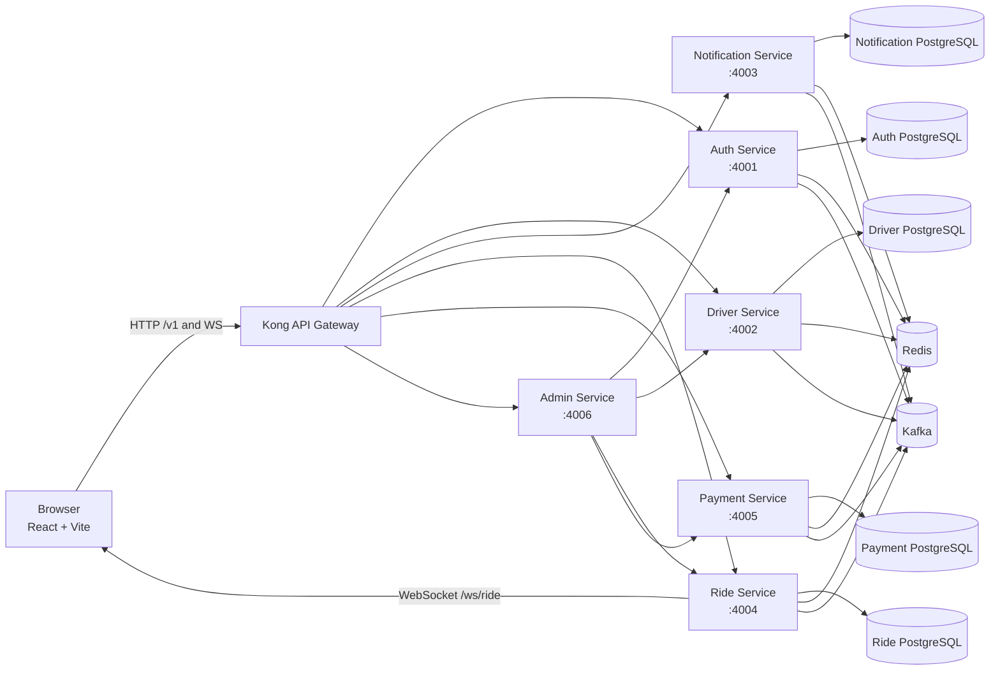
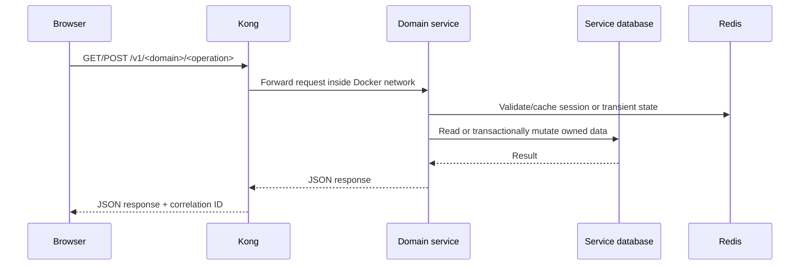
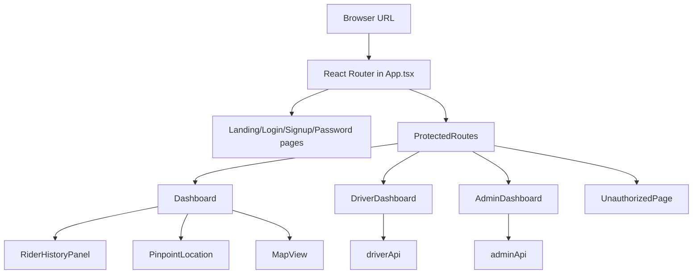
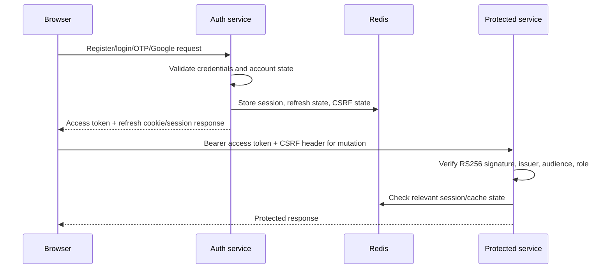
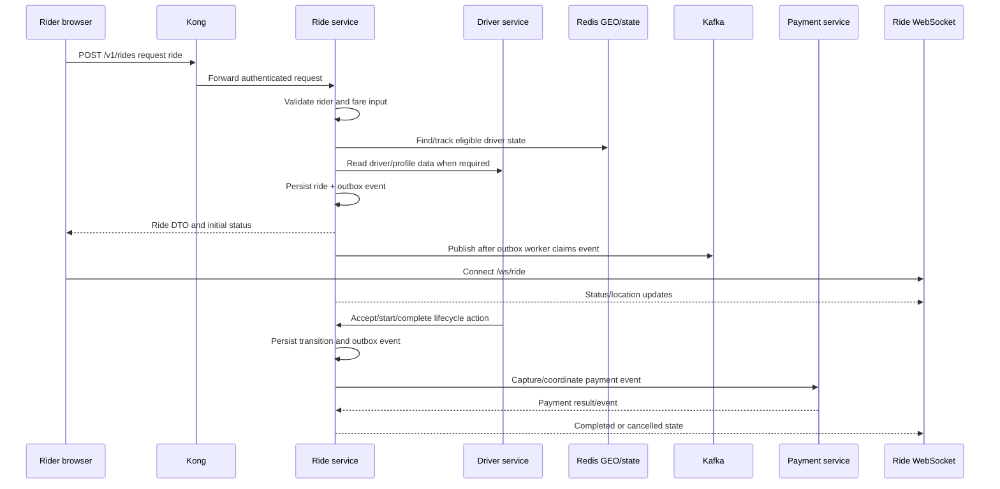
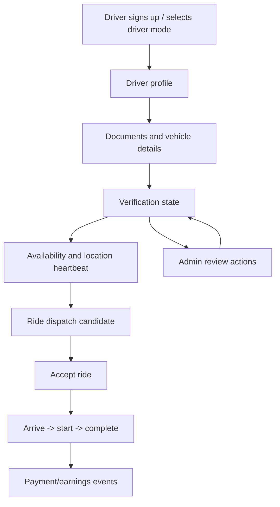
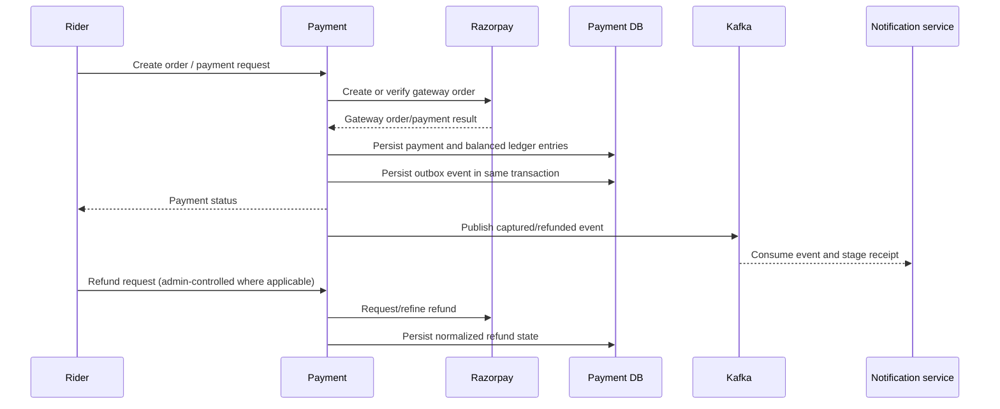
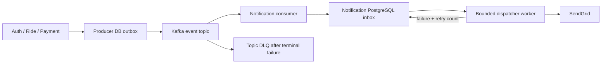
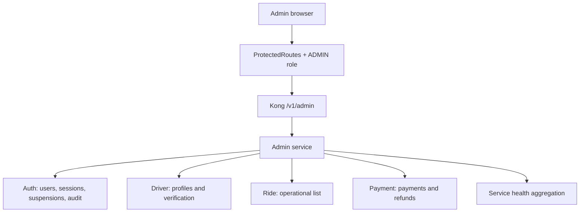
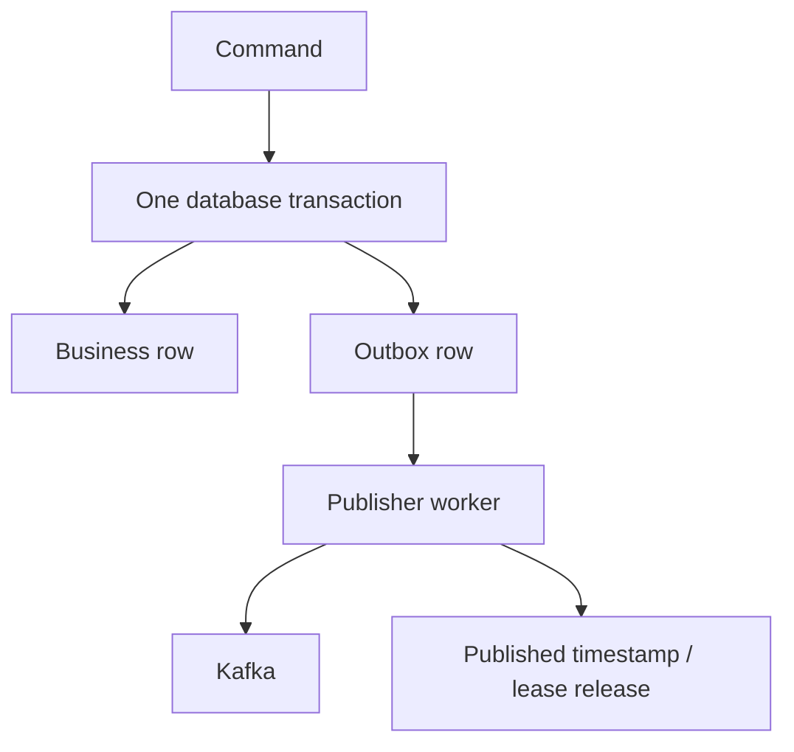

# UrbanFleet

UrbanFleet is a full-stack ride-hailing and fleet-operations project built as a
student portfolio application. It demonstrates how a React single-page
application can coordinate with independently deployable TypeScript services,
PostgreSQL databases, Redis, Kafka, Kong, WebSockets, third-party payment and
email providers, and an administrator console.

This README is the system guide: it explains what is implemented, where it is
implemented, how a request moves through the system, how to run it, and which
parts are intentionally simplified for a single-machine showcase deployment.

> **Important:** This repository contains both a local development profile and
> a small production-style Docker profile. The Compose file runs Kafka and
> Kong locally, while PostgreSQL and Redis are supplied through environment
> variables in the deployment used by the project owner. CI starts temporary
> PostgreSQL and Redis services for automated checks.

## Table of contents

1. [What the project demonstrates](#what-the-project-demonstrates)
2. [Architecture at a glance](#architecture-at-a-glance)
3. [Repository map](#repository-map)
4. [Runtime components and ownership](#runtime-components-and-ownership)
5. [Frontend flows](#frontend-flows)
6. [Authentication and session flow](#authentication-and-session-flow)
7. [Ride booking flow](#ride-booking-flow)
8. [Driver flow](#driver-flow)
9. [Payment and refund flow](#payment-and-refund-flow)
10. [Notification flow](#notification-flow)
11. [Administrator flow](#administrator-flow)
12. [Synchronous and asynchronous communication](#synchronous-and-asynchronous-communication)
13. [Data ownership and persistence](#data-ownership-and-persistence)
14. [Security model](#security-model)
15. [Reliability patterns](#reliability-patterns)
16. [Local setup](#local-setup)
17. [Docker and EC2 deployment](#docker-and-ec2-deployment)
18. [Testing, linting, and CI](#testing-linting-and-ci)
19. [Troubleshooting](#troubleshooting)
20. [Known boundaries and future improvements](#known-boundaries-and-future-improvements)

---

## What the project demonstrates

UrbanFleet is more than a CRUD ride form. Its main learning goals are:

- **React and TypeScript UI:** public landing pages, login/signup, rider
  dashboard, driver dashboard, live ride state, maps, ride history, and an
  admin console.
- **Microservice boundaries:** identity, drivers, rides, payments,
  notifications, and administration have separate code and data ownership.
- **Database-per-service thinking:** each domain uses its own Prisma schema and
  PostgreSQL database instead of sharing tables across services.
- **Synchronous APIs:** Kong exposes stable `/v1/...` routes and forwards them
  to internal services.
- **Asynchronous events:** Kafka carries domain events so notification and
  downstream processing do not block the original HTTP request.
- **Real-time updates:** the ride service exposes a native WebSocket route for
  ride status and location updates.
- **Security:** RS256 JWTs, role checks, CSRF protection for browser mutations,
  Redis-backed session/token state, Helmet, CORS, rate limiting, and
  least-privilege database users.
- **Reliability:** transactional outbox publishing, consumer idempotency,
  retry/backoff, dead-letter queues, durable notification inbox records, and
  WebSocket state rehydration.
- **Operations:** health checks, Docker orchestration, migrations, CI builds,
  DLQ replay tooling, and a protected Stage 1 admin panel.

## Architecture at a glance



### Request path in production



Kong is the public API boundary. Services are exposed internally with
`expose`, not normal host port mappings. The frontend is served by Nginx
inside its container and is reached through the frontend catch-all route.

## Repository map

```text
urbanfleet-project/
├── frontend/                         React/Vite browser application
│   ├── src/                          pages, components, hooks, API clients
│   ├── Dockerfile                    Vite build + Nginx runtime image
│   ├── nginx.conf                    SPA fallback and static serving
│   └── package.json                  frontend scripts and dependencies
├── packages/
│   ├── common/                       shared logger, errors, auth/Kafka helpers
│   └── contracts/                    shared event envelopes and validation
├── services/
│   ├── auth-service/                 users, credentials, JWTs, sessions, CSRF
│   ├── driver-service/               driver profiles, documents, vehicles
│   ├── ride-service/                 ride lifecycle, dispatch, WebSockets
│   ├── payment-service/              Razorpay integration and ledger
│   ├── notification-service/         durable email notification processing
│   └── admin-service/                protected operations aggregation API
├── infra/
│   ├── init-databases.sql            database and least-privilege role setup
│   ├── kafka-init.sh                 Kafka topic and DLQ creation
│   └── kong/kong.yml                 declarative gateway routes/plugins
├── scripts/
│   ├── replay-dlq.ts                 validated dead-letter redrive utility
│   └── wait-for-dependencies.cjs     container startup dependency wait
├── certs/                            local/generated JWT key material
├── test/                             repository-level test support
├── docker-compose.yml                local/small deployment orchestration
├── .github/workflows/ci.yml          CI checks and image validation
├── .github/workflows/cd.yml          manual deployment-readiness workflow
├── .env.example                      configuration template
└── package.json                      npm workspaces and root commands
```

Generated `node_modules`, service `dist` directories, Vite `dist`, and Prisma
generated clients are build artifacts, not application source. The root
`package-lock.json` and `frontend/package-lock.json` keep the two npm
installations reproducible.

## Runtime components and ownership

| Component | Port | Owns | Main communication |
|---|---:|---|---|
| Kong | host `3001` / HTTP `8000` | ingress routing and global plugins | HTTP, HTTPS, WebSocket upgrade |
| Frontend | container `5173` | browser UI | calls Kong `/v1` |
| Auth | `4001` | users, roles, sessions, verification, audit records | HTTP, Redis, Kafka |
| Driver | `4002` | driver profile, documents, vehicles, driver state | HTTP, Redis, Kafka |
| Notification | `4003` | notification inbox and delivery state | Kafka, SendGrid |
| Ride | `4004` | ride aggregate, lifecycle, dispatch, location | HTTP, Redis, Kafka, WebSocket |
| Payment | `4005` | orders, captures, refunds, ledger | HTTP, Razorpay, Kafka |
| Admin | `4006` | admin aggregation and controlled operations | HTTP to domain services |
| PostgreSQL | external or CI service | one database per domain | Prisma |
| Redis | external or CI service | sessions, cache, GEO/ephemeral state | Redis clients |
| Kafka | container `kafka:29092` | event transport and DLQs | KafkaJS/shared client |

### Domain ownership rule

The admin service does not directly query another service's database. It calls
that domain's API. Auth owns user suspension and audit persistence; driver owns
driver verification; ride owns ride state; payment owns payment/refund state.
This keeps business rules near the data they protect.

## Repository map by code layer

Most services follow the same practical layering:

```text
src/
├── index.ts              process bootstrap, middleware, routes, workers
├── routes/               URL definitions and route-level authorization
├── controllers/          request extraction and response formatting
├── services/             domain use cases and transaction boundaries
├── repositories/         database queries (where present)
├── clients/              calls to another internal service/provider
├── middlewares/          auth, errors, async handling, CSRF
├── consumers/            Kafka handlers
├── workers/              outbox/inbox/background polling
├── redis/                Redis connection and cache helpers
├── db/                   Prisma client/database adapter
├── validation/           Zod/request schemas
└── utils/                DTO conversion and small shared helpers
```

This is a guide to the important source surfaces, not a claim that every
service has every directory. The exact implementation is visible in each
service's `src` tree.

## Frontend flows

The frontend is a React 19 + TypeScript + Vite SPA. `src/main.tsx` bootstraps
React, `src/App.tsx` defines routes and lazy-loaded pages, and
`src/apiInterceptor.ts` creates Axios clients with token attachment, refresh
handling, CSRF headers, and retry queue behavior.

### Browser route flow



`ProtectedRoutes` checks the current browser auth context before rendering
protected UI. This is a user-experience guard, not the security boundary:
each backend route still verifies the bearer token and role.

### Location selection

`PinpointLocation.tsx` provides the reusable location modal used by rider
booking flows:

1. It opens a Leaflet map centered on the supplied coordinates or the project
   default location.
2. The user searches Geoapify places through `searchPlaces`.
3. A selected feature is converted by `getGeoapifyPoint` into application
   coordinates.
4. Dragging the map updates the center coordinates.
5. `reverseGeocodeFn` resolves the center to a display address.
6. A sequence counter prevents an older reverse-geocoding response from
   overwriting a newer selection.
7. `onConfirm(address, coords)` returns the final value to the booking page.
8. ResizeObserver and Leaflet cleanup keep the map stable when the modal closes.

### Rider history

`RiderHistoryPanel.tsx` loads `/rides/history` and falls back to legacy route
variants for compatibility. It normalizes either an array response or
`{ rides: [...] }`, displays completed/cancelled filters, totals, distance,
duration, ratings, and exposes rebooking through the original pickup and
destination coordinates.

### Production refresh behavior

The browser uses history URLs such as `/driver-dashboard`. Navigation inside
React does not contact Nginx, but a hard refresh does. `frontend/nginx.conf`
uses:

```nginx
try_files $uri $uri/ /index.html;
```

Therefore Nginx returns the SPA entry point for a frontend route, and React
Router renders the correct page. API paths remain Kong routes. Without this
fallback, production returns `Cannot GET /driver-dashboard`, while Vite
development mode appears to work.

## Authentication and session flow



The auth service issues RS256 tokens. Other services need the public key for
verification; they do not need the private signing key. Browser access tokens
are synchronized through memory and `sessionStorage` by the frontend
interceptor. Refresh failures clear the access token rather than returning a
false authenticated state.

Supported identity concerns include registration, login, verification,
password reset, refresh, active-session management, role enforcement,
suspension, and explicit admin provisioning. Public registration cannot grant
the `ADMIN` role.

## Ride booking flow



The ride service owns the lifecycle: searching, assignment, arrival, start,
destination arrival, completion, and cancellation. Redis is suitable for
short-lived driver availability/location state; PostgreSQL remains the
authoritative ride record. On WebSocket reconnect, the browser can rehydrate
current state through the HTTP current-ride endpoint.

## Driver flow



The driver service owns driver-specific information and exposes driver-facing
routes through `driverApi`. Documents and vehicle metadata are not owned by
auth. Cloudinary configuration is used for driver image/document integration
where configured. Ride state remains owned by ride-service even when a driver
initiates a lifecycle action.

## Payment and refund flow



Payment amounts are represented in paise. The payment service validates
double-entry ledger balance before committing journal entries:

```text
sum(debits) - sum(credits) = 0
```

Gateway webhooks are routed by Kong to the payment service. Refunds must remain
owned by payment-service because gateway lifecycle, duplicate requests, and
reconciliation are payment concerns.

## Notification flow



The notification service deliberately does not send email inside the original
HTTP request. Its consumer stages a durable notification record, then a
separate dispatcher polls a bounded batch of pending records. This isolates
SendGrid latency and outages from login, ride, and payment APIs.

Deduplication uses two barriers:

1. `processed_events` prevents the same Kafka event from being handled twice
   for the consumer group.
2. A deterministic notification idempotency key and database uniqueness
   prevent duplicate business notifications.

## Administrator flow

The protected admin UI is `/admin`. The API is `/v1/admin` through Kong.
`admin-service` aggregates data from auth, driver, ride, and payment services,
but domain services retain ownership of mutations.



Stage 1 surfaces include:

- overview and operational summaries;
- users, suspension/restoration, and session revocation;
- driver review and verification actions;
- ride and payment lists with pagination;
- refund requests through payment-service;
- service health;
- audit history;
- fleet/radar and settings UI surfaces.

An administrator is provisioned explicitly after a verified normal account
exists:

```bash
ADMIN_EMAIL=admin@example.com \
ADMIN_BOOTSTRAP_SECRET='<24-or-more-character-secret>' \
npm run admin:grant --workspace=@urbanfleet/auth-service
```

The browser guard improves UX; the admin middleware verifies the RS256 token
and ADMIN role; downstream services authorize their own domain routes.

## Synchronous and asynchronous communication

### HTTP

Use HTTP when the caller needs an immediate result: login, list rides, create a
ride, read profile data, request a payment order, or load admin data.

### WebSocket

Use `/ws/ride` for low-latency ride state and location updates. The frontend
keeps the connection alive and reconnects with backoff. HTTP remains the
recovery source of truth after reconnect.

### Kafka

Use Kafka for events such as user registration, ride lifecycle changes, payment
capture/refund, and notification work. Topic names are created by
`infra/kafka-init.sh`:

```text
urbanfleet.auth.events
urbanfleet.driver.events
urbanfleet.ride.events
urbanfleet.payment.events
urbanfleet.notification.events
```

Each has a corresponding `.DLQ` topic. Normal topics use three partitions in
the initialization script; the bundled single-broker profile intentionally
uses replication factor one.

## Data ownership and persistence

The database initialization script creates:

```text
urbanfleet_auth
urbanfleet_driver
urbanfleet_ride
urbanfleet_payment
urbanfleet_notification
```

Each database has a dedicated role. Prisma migrations and generated clients
are maintained inside each service. A service must not import another
service's Prisma client or connect to its database directly.

Typical durable records include:

- auth users, sessions, verification/reset state, outbox records, and admin
  audit logs;
- driver profiles, documents, vehicles, and processed event identifiers;
- rides, lifecycle data, outbox records, and processed event identifiers;
- payments, refunds, journal entries, and outbox records;
- notification records, inbox/processed events, retry state, and delivery
  timestamps.

Redis holds state that benefits from fast access or expiration: session/cache
entries, driver GEO/heartbeat data, transient dispatch state, and coordination
keys. Redis is not a replacement for the authoritative domain databases.

## Security model

### Application security

- RS256 JWTs provide asymmetric signing and verification.
- Issuer and audience are validated.
- Role checks are enforced at service routes.
- Suspended users are rejected by authentication middleware.
- Browser mutations include CSRF protection.
- Redis outages fail closed for security-sensitive CSRF/session checks.
- Helmet adds standard HTTP security headers.
- Kong provides CORS and selected rate limiting.
- Correlation IDs are propagated as `X-Request-ID`.
- Secrets and private keys come from environment/configuration, not source.
- Database roles are separated by service.

### Deployment security

- Kong Admin is bound to loopback in Compose.
- Domain service ports are not published to the host.
- Kafka host access is bound to localhost; containers use `kafka:29092`.
- HTTPS certificates can be mounted through `LETSENCRYPT_DIR`.
- Never commit `.env`, private keys, payment secrets, or provider keys.

The `certs/` directory may contain local/generated key material. Production
keys should be supplied through a secure secret mechanism and rotated through
an operational process.

## Reliability patterns

### Transactional outbox

When a business mutation must emit an event, the service writes the domain
change and outbox row in one database transaction. A worker later claims
unpublished rows, publishes to Kafka, and marks them published. Lease recovery
allows another worker to retry a row left behind by a crash.



### Consumer idempotency

Consumers commit the business update and `processed_events` insert together.
Kafka offsets are committed only after successful processing or confirmed DLQ
publication. Redelivery therefore becomes a safe no-op rather than a duplicate
business mutation.

### Retry and DLQ

Transient failures use bounded exponential backoff. Terminal or malformed
messages are published to a service DLQ. The original message value is
preserved for safe replay.

```bash
npm run dlq:replay -- \
  --topic urbanfleet.payment.events.DLQ \
  --limit 10
```

The replay utility validates that the source is a DLQ topic, validates the
envelope, restores the original value, and refuses records that cannot be
replayed safely.

## Supporting files and configuration artifacts

These files are easy to overlook but are part of the project's operational
story:

| Path | Purpose |
|---|---|
| `scripts/generate-keys.js` | Generates the RS256 key material used by auth and token verifiers. |
| `scripts/seed-all.js` | Coordinates seed execution when preparing service databases. |
| `scripts/wait-for-dependencies.cjs` | Prevents a service from running migrations before required dependencies are reachable. |
| `services/*/Dockerfile` | Builds each service from the monorepo context, compiles TypeScript, and creates the runtime image. This includes `admin-service`. |
| `services/*/prisma/migrations/` | Versioned schema changes applied with `prisma migrate deploy` during container startup. |
| `services/*/.env.example` | Service-specific configuration examples; root `.env.example` is the Compose-level template. |
| `frontend/.env.example` | Frontend-only Vite variables such as API and WebSocket URLs. |
| `frontend/vercel.json` | Frontend hosting/rewrite configuration for a Vercel-style deployment. |
| `frontend/nginx.conf` | Nginx static serving, security headers, compression, and SPA history fallback for Docker. |
| `frontend/index.html` | Vite HTML entry point into `src/main.tsx`. |
| `frontend/eslint.config.js` | Frontend ESLint rules. |
| `frontend/tsconfig*.json` | Separate app and Node/Vite TypeScript project references. |
| `components.json` / `frontend/components.json` | UI component-generation metadata used by the frontend tooling. |
| `tsconfig.base.json` | Shared TypeScript compiler baseline for the monorepo. |
| `vitest.config.ts` | Root Vitest discovery and test configuration. |
| `.dockerignore` and `frontend/.dockerignore` | Keep secrets, dependencies, and build noise out of Docker contexts. |
| `.gitignore` and `frontend/.gitignore` | Keep environment files, generated output, dependencies, and local artifacts out of Git. |

Prisma migration directories are not interchangeable: a migration belongs to
the service whose schema it changes. Applying one service's migration to
another database violates the ownership boundary.

## Local setup

### Prerequisites

- Node.js 22 (Node.js 20+ is generally suitable for development)
- npm
- Docker Desktop and Docker Compose v2
- optional: PostgreSQL client tools for manual database inspection

### Install

```bash
git clone <repository-url>
cd urbanfleet-project
copy .env.example .env       # Windows PowerShell
npm ci
```

On macOS/Linux, use `cp .env.example .env`.

Generate local JWT keys:

```bash
npm run keys:generate
```

Set the generated values and provider configuration in `.env`. For a hosted
PostgreSQL/Redis setup, set the service-specific database URLs and `REDIS_URL`
to reachable addresses. Do not use `localhost` for a dependency that lives
outside the current container.

### Build and test without Docker

```bash
npm run typecheck
npm test
npm run build

cd frontend
npm run lint
npm run build
```

### Start the stack

```bash
docker compose up -d --build
docker compose ps
docker compose logs -f kong
```

Compose starts Kafka, topic initialization, Kong, the frontend, all domain
services, and the admin service. PostgreSQL and Redis are intentionally
configured through environment variables in the current deployment profile;
they are not silently replaced by local containers.

Open the configured domain or local gateway URL. The frontend is normally
available through Kong on port 80/443, while `http://localhost:3001` is the
development gateway mapping when used.

### Useful commands

```bash
docker compose ps
docker compose logs -f auth-service
docker compose logs -f ride-service
docker compose exec kafka kafka-topics --bootstrap-server kafka:29092 --list
docker compose down
```

## Docker and EC2 deployment

The intended small deployment is one AWS EC2 machine running Docker Compose:

```text
DuckDNS domain
      |
      v
EC2 public IP
      |
  ports 80/443
      |
    Kong
   /     \
Nginx   /v1 APIs
frontend   services
```

Recommended deployment sequence:

1. Install Docker and Compose on the EC2 host.
2. Configure DNS so the domain points to the EC2 public IP.
3. Open only required security-group ports, normally 80 and 443 (and SSH
   restricted to your own IP).
4. Install the repository without copying secrets into Git.
5. Create `.env` with production URLs, keys, provider credentials, and
   `FRONTEND_URL`.
6. Mount or configure TLS certificates.
7. Run `docker compose build` and `docker compose up -d`.
8. Check `docker compose ps` and each health endpoint.
9. Verify login, rider booking, driver dashboard, WebSocket updates, payment
   webhook routing, and `/admin`.

### Why `kafka:29092` matters

Containers resolve each other by Compose service name. Inside a container,
`localhost` means that same container, not the EC2 host and not Kafka.
Therefore services use `kafka:29092`. Host-side tools can use the
localhost-bound `9092` listener.

### Why frontend refresh needs Nginx fallback

See the [production refresh behavior](#production-refresh-behavior). Kong
routes frontend paths to Nginx; Nginx must return `index.html` for a React
route while leaving API routes under `/v1` untouched.

## Testing, linting, and CI

### Local test layers

| Check | Command | Purpose |
|---|---|---|
| shared/service tests | `npm test` | Vitest unit and invariant tests |
| frontend lint | `npm run lint --prefix frontend` | ESLint |
| frontend build | `npm run build --prefix frontend` | TypeScript + Vite bundle |
| monorepo typecheck | `npm run typecheck` | shared packages and services |
| production build | `npm run build` | all workspace builds |
| Compose validation | `docker compose config` | interpolated Compose syntax |

### CI workflow

`.github/workflows/ci.yml`:

1. starts temporary PostgreSQL and Redis service containers;
2. installs with `npm ci`;
3. initializes five databases and roles;
4. generates Prisma clients;
5. builds shared packages;
6. typechecks packages and services;
7. runs Vitest;
8. builds the monorepo;
9. builds service Docker images;
10. separately installs, lints, and builds the frontend.

`.github/workflows/cd.yml` is a manually dispatched readiness workflow. It
repeats installation, Prisma generation, typechecking, tests, builds, and
container image builds before the deployment placeholder job reports the
selected environment and commit SHA.

## Troubleshooting

### `Cannot GET /driver-dashboard` after refresh

Ensure the request reaches the frontend Nginx server and that
`frontend/nginx.conf` contains the SPA fallback. Rebuild the frontend image:

```bash
docker compose build frontend
docker compose up -d frontend
```

### API calls go to the wrong host

Check `VITE_API_URL`, `FRONTEND_URL`, and whether the browser is using HTTP or
HTTPS. The frontend interceptor avoids sending browser HTTPS requests to an
HTTP API because that would create mixed-content failures.

### Services cannot connect to Kafka

Use `KAFKA_BROKERS=kafka:29092` inside Compose. Confirm Kafka and `kafka-init`
are healthy before starting dependent services:

```bash
docker compose ps kafka kafka-init
docker compose logs kafka-init
```

### Database migration or connection failure

Check every service's database URL, direct migration URL, DNS name, SSL
requirements, and database role permissions. The service command runs
`prisma migrate deploy` before starting the compiled process.

### Authentication works once but later fails

Check Redis reachability, refresh-cookie attributes, `COOKIE_SECURE`,
`COOKIE_DOMAIN`, issuer/audience values, and matching RS256 public/private key
configuration. A suspended or revoked session is expected to fail closed.

### WebSocket does not update

Verify Kong exposes `/ws/ride`, the browser uses the correct `VITE_WS_URL`,
HTTPS uses a secure WebSocket URL, and the ride service is healthy. Inspect
both Kong and ride-service logs.

### Email is delayed

This is expected when the notification inbox is retrying. Inspect notification
records, SendGrid credentials, Kafka consumer logs, and retry counts rather
than blocking the original ride or auth request.

## Known boundaries and future improvements

This is a serious portfolio project, but it is not presented as an
unlimited-scale commercial platform. The following boundaries should be
understood honestly:

- The bundled Kafka profile is one broker; production Kafka needs multiple
  brokers and stronger replication settings.
- External PostgreSQL and Redis availability, backups, TLS, and monitoring are
  deployment responsibilities.
- The Stage 1 admin panel is an operations foundation; MFA, fine-grained admin
  permissions, approval workflows, and production-grade audit policy are
  natural next steps.
- Live fleet telemetry requires a real location-ingestion pipeline and
  retention policy; a map view must not be described as real-time unless its
  coordinates come from active driver telemetry.
- Analytics should use authoritative aggregation queries rather than bounded
  UI samples when used for business reporting.
- Payment refunds require gateway idempotency, reconciliation, and operational
  review in a real deployment.
- Rate limiting, secret rotation, backups, alerts, tracing, and disaster
  recovery should be expanded before exposing the system to untrusted public
  traffic at scale.

## Portfolio summary

UrbanFleet is a strong student showcase because it demonstrates the complete
path from browser interaction to domain persistence, asynchronous events,
third-party integration, real-time updates, security middleware, operational
containers, and CI verification. When presenting it, describe it accurately:
it is a production-minded educational system with explicit reliability and
security patterns, deployed as a compact Dockerized application rather than a
claim of hyperscale infrastructure.

For deeper design decisions, read:

- [`URBANFLEET_MICROSERVICES_ARCHITECTURE_SPEC.md`](./URBANFLEET_MICROSERVICES_ARCHITECTURE_SPEC.md)
- [`DECOUPLED_RIDER_DRIVER_ARCHITECTURE_PLAN.md`](./DECOUPLED_RIDER_DRIVER_ARCHITECTURE_PLAN.md)
- [`SESSION_MANAGEMENT_AND_VERSIONING_ARCHITECTURE.md`](./SESSION_MANAGEMENT_AND_VERSIONING_ARCHITECTURE.md)
- [`services/notification-service/README.md`](./services/notification-service/README.md)
