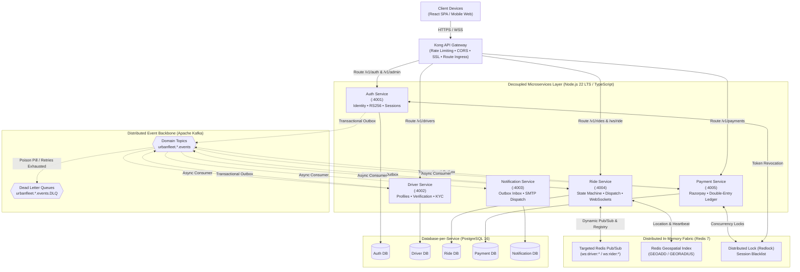
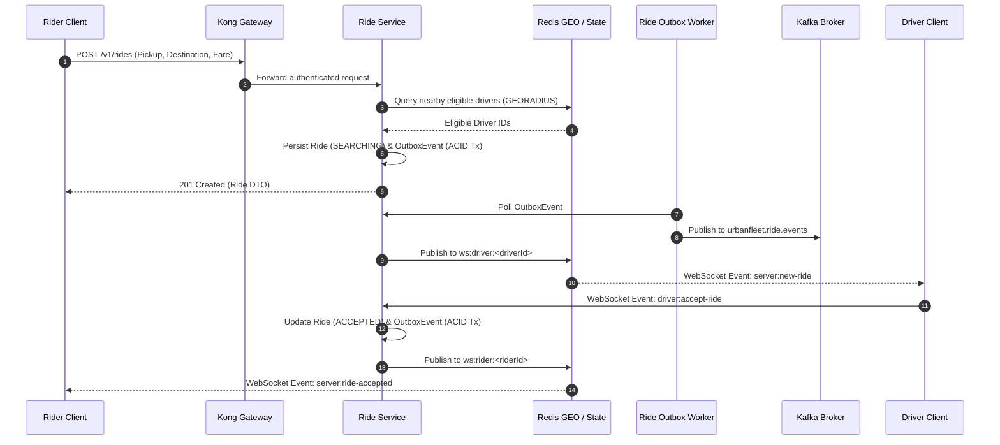
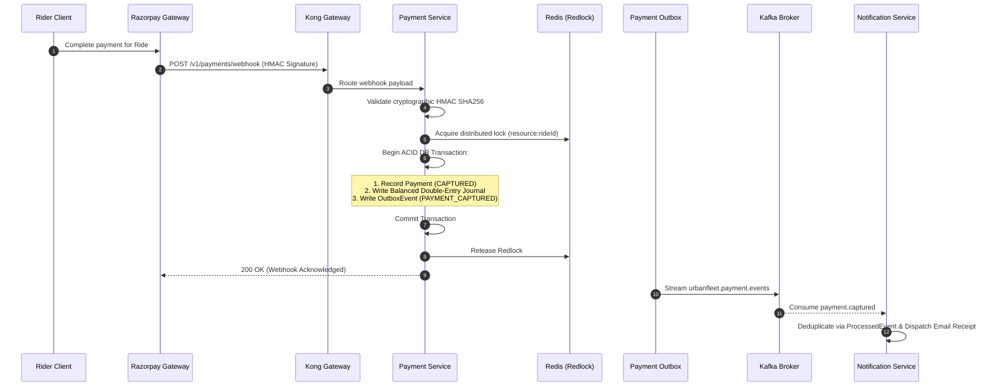

# UrbanFleet

**Enterprise-Grade Distributed Ride-Hailing, Real-Time Telemetry & Financial Ledgering Platform**

[](https://nodejs.org/)
[](https://www.typescriptlang.org/)
[](https://kafka.apache.org/)
[](https://redis.io/)
[](https://www.postgresql.org/)
[](https://konghq.com/)
[](https://www.docker.com/)
[](https://vitest.dev/)

---

## Executive Summary

> **UrbanFleet is not a CRUD-based ride application.** It is an enterprise-grade distributed systems platform engineered from first principles to solve the hardest challenges in high-concurrency mobility networks and financial settlement: **dual-write database/broker consistency**, **at-least-once to exactly-once message delivery**, **poison-pill isolation**, **immutable double-entry financial ledgering**, and **cluster-wide real-time WebSocket state synchronization**.

Built across 5 decoupled microservices with strict **Database-per-Service isolation**, UrbanFleet guarantees that no distributed transaction can leak, no financial ledger entry can be unbalanced, and no client event is dropped when nodes scale horizontally.

### Core Engineering Feats at a Glance

* **Transactional Outbox Pattern & Background Workers:** Eliminates dual-write inconsistencies between PostgreSQL and Kafka without distributed two-phase commit (2PC) transactions. Domain updates and outbox events commit atomically in a single local ACID transaction. Polling workers claim events using lease locks, publish to Kafka with `acks: -1`, and safely handle process crashes.
* **Exactly-Once Consumer Semantics:** Ingests at-least-once Kafka streams and achieves deterministic exactly-once processing using consumer deduplication tables (`ProcessedEvent`) committed atomically with business mutations.
* **Resilient Consumer Pipeline & Poison-Pill DLQ Redrive:** Features exponential backoff retries, poison-pill isolation, automated Dead Letter Queue (`.DLQ`) routing, and a dedicated, validated DLQ Replay CLI (`npm run dlq:replay`).
* **Horizontally Scaled Native WebSockets via Dynamic Redis Pub/Sub:** Clustered WebSocket nodes synchronize real-time telemetry and state changes using scoped, dynamic Redis Pub/Sub channels (`ws:driver:<id>`, `ws:rider:<id>`) paired with an in-memory dual-indexed `Set<WebSocket>` registry with reference counting.
* **Immutable Double-Entry Financial Ledger:** Every payment capture and driver payout is recorded as balanced double-entry accounting journal entries (`sum(debits) - sum(credits) === 0`) in integer paise precision, protected against race conditions using distributed Redis Redlocks.
* **Sub-10ms Geospatial Dispatch Engine:** High-throughput driver location tracking and proximity matching powered by Redis Geospatial indexes (`GEOADD`, `GEORADIUS`), active driver presence heartbeats, and automated offline reaping.
* **Zero-Trust Asymmetric Security Model:** Kong API Gateway ingress routing, RS256 asymmetric cryptographic token verification (private key isolated strictly to `auth-service`), fail-closed Redis session blacklisting, and CSRF protection.
* **Production-Grade Test Rigor:** 54 test suites and 560+ automated unit, integration, and failure-mode tests executing with 100% green pass rates.

---

## Table of Contents

1. [High-Level System Architecture](#high-level-system-architecture)
2. [Microservice Boundaries & Responsibilities](#microservice-boundaries--responsibilities)
3. [Deep-Dive: The 7 Core Distributed Engineering Patterns](#deep-dive-the-7-core-distributed-engineering-patterns)
   * [1. Transactional Outbox Pattern](#1-transactional-outbox-pattern)
   * [2. Exactly-Once Processing via Receiver Idempotency](#2-exactly-once-processing-via-receiver-idempotency)
   * [3. Resilient Consumer Pipeline & Poison-Pill DLQ Architecture](#3-resilient-consumer-pipeline--poison-pill-dlq-architecture)
   * [4. Clustered Native WebSockets via Targeted Redis Pub/Sub](#4-clustered-native-websockets-via-targeted-redis-pubsub)
   * [5. Immutable Double-Entry Ledger & Payment Settlement](#5-immutable-double-entry-ledger--payment-settlement)
   * [6. Geospatial Dispatch Engine & Presence Tracking](#6-geospatial-dispatch-engine--presence-tracking)
   * [7. Asymmetric Security & Fail-Closed Session Revocation](#7-asymmetric-security--fail-closed-session-revocation)
4. [End-to-End System Workflows](#end-to-end-system-workflows)
   * [Ride Booking, Matching & Lifecycle](#ride-booking-matching--lifecycle)
   * [Payment Capture, Webhook & Ledger Balance](#payment-capture-webhook--ledger-balance)
   * [Distributed Real-Time WebSocket Telemetry Flow](#distributed-real-time-websocket-telemetry-flow)
5. [Data Topology & Database-per-Service Model](#data-topology--database-per-service-model)
6. [Repository Structure & Monorepo Map](#repository-structure--monorepo-map)
7. [Local Setup & Development](#local-setup--development)
8. [Docker & Production Deployment (EC2)](#docker--production-deployment-ec2)
9. [Testing & Quality Assurance](#testing--quality-assurance)

---

## High-Level System Architecture



---

## Microservice Boundaries & Responsibilities

| Service | Port | Primary Responsibility | Data Store | Key Technologies |
| :--- | :---: | :--- | :--- | :--- |
| **`auth-service`** | `4001` | Asymmetric authentication (RS256), user lifecycle, session versioning, fail-closed revocation, admin operational aggregation. | PostgreSQL (`urbanfleet_auth`) | Prisma, JWT (RS256), Redis, Kafka |
| **`driver-service`** | `4002` | Driver onboarding, document uploads, KYC verification state machine, vehicle registries. | PostgreSQL (`urbanfleet_driver`) | Prisma, Cloudinary, Kafka |
| **`ride-service`** | `4004` | Ride state machine, dispatch matching engine, real-time telemetry, clustered WebSockets. | PostgreSQL (`urbanfleet_ride`) | Prisma, Redis GEO, Native `ws`, Redis Pub/Sub, Kafka |
| **`payment-service`** | `4005` | Payment intent orders, Razorpay integration, double-entry financial ledger, payouts, reconciliation. | PostgreSQL (`urbanfleet_payment`) | Prisma, Razorpay SDK, Redlock, Kafka |
| **`notification-service`** | `4003` | Asynchronous durable notification inbox, email templating, rate-limited SMTP dispatching. | PostgreSQL (`urbanfleet_notification`) | Prisma, Nodemailer, Kafka |

---

## Deep-Dive: The 7 Core Distributed Engineering Patterns

### 1. Transactional Outbox Pattern
**The Problem Solved:** When a service creates a ride or captures a payment, writing to the database and publishing to Kafka in two separate steps causes fatal inconsistency: if Kafka is down or the network blips, the DB commit succeeds but downstream services never know; if the DB fails after publishing, phantom events are processed.

**The Implementation:**
1. Within an ACID transaction, the service writes the business row (e.g. `Ride`) and an `OutboxEvent` row simultaneously to PostgreSQL:
   ```typescript
   await prisma.$transaction(async (tx) => {
     const ride = await tx.ride.create({ data: rideData });
     await tx.outboxEvent.create({
       data: {
         id: crypto.randomUUID(),
         aggregateType: 'Ride',
         aggregateId: ride.id,
         eventType: 'RIDE_REQUESTED',
         payload: JSON.stringify(ride),
         status: 'PENDING',
       },
     });
   });
   ```
2. A resilient background `OutboxWorker` polls batches of `PENDING` events using lease-based row locking (`SELECT ... FOR UPDATE SKIP LOCKED` semantics).
3. The worker publishes the event to Kafka with producer acknowledgement `acks: -1` (all in-sync replicas must acknowledge).
4. Upon confirmed broker receipt, the worker marks the outbox entry `PUBLISHED`. If a worker crashes, lease timeouts allow a peer worker to reclaim the event.

---

### 2. Exactly-Once Processing via Receiver Idempotency
**The Problem Solved:** Kafka provides *at-least-once* delivery semantics over the network. In the event of consumer rebalances or transient network retries, the same message may arrive multiple times.

**The Implementation:**
1. Every event carries a standardized envelope containing a globally unique `eventId`:
   ```typescript
   export interface KafkaEnvelope<T> {
     eventId: string;
     eventType: string;
     aggregateType: string;
     aggregateId: string;
     aggregateSequence: number;
     timestamp: string;
     version: string;
     payload: T;
   }
   ```
2. Each consumer service maintains a `ProcessedEvent` table with a `PRIMARY KEY (eventId, consumerGroup)`.
3. When consuming an event, the business mutation and the `ProcessedEvent` insertion are executed within the **same local database transaction**:
   ```typescript
   await prisma.$transaction(async (tx) => {
     await tx.processedEvent.create({
       data: { eventId, consumerGroup: 'ride-payment-sync' },
     });
     await tx.ride.update({ where: { id: rideId }, data: { paymentStatus: 'CAPTURED' } });
   });
   ```
4. If a duplicate message arrives, the database rejects the duplicate `eventId` with a unique key constraint violation (`P2002`). The consumer catches the duplicate and commits the offset cleanly as a no-op, preventing double-execution.

---

### 3. Resilient Consumer Pipeline & Poison-Pill DLQ Architecture
**The Problem Solved:** Malformed JSON, schema version mismatches, or persistent 500 bugs ("poison pills") can block a Kafka partition indefinitely, causing event lag to compound across the entire cluster.

**The Implementation:**
* **Non-Retryable Errors (4xx, Schema Failures, Malformed Payloads):** Diverted **immediately** to the Dead Letter Queue (`urbanfleet.<domain>.events.DLQ`) without blocking consumer threads.
* **Transient Infrastructure Errors (5xx, Network Timeouts):** Retried using bounded exponential backoff with randomized jitter. If all retry attempts are exhausted, the message is routed to the `.DLQ` with complete error diagnostics preserved in headers.
* **Automated Redrive Tooling:** A dedicated CLI utility allows operations to inspect, filter, and safely re-inject dead-lettered events back into primary topics once bugs are patched:
  ```bash
  npm run dlq:replay -- --topic urbanfleet.payment.events.DLQ --limit 50
  ```

---

### 4. Clustered Native WebSockets via Targeted Redis Pub/Sub
**The Problem Solved:** Standard WebSocket implementations store client sockets in single-server memory. In a multi-replica deployment behind a load balancer, Driver $D_1$ is connected to Node 1, while the ride matching algorithm runs on Node 2. Node 2 cannot call `socket.send()` on Node 1's memory.

```
[Ride Event Triggered on Node 2]
         │
         ▼
[Node 2 Emitter] ──(redisPub.publish("ws:driver:D1", payload))──► [Redis Cluster]
                                                                        │
                                                   Routes ONLY to nodes │
                                                   holding active sub   │
                                                                        ▼
                                                             [Node 1 (Node.js RAM)]
                                                                        │
                                                              Local Map Lookup (O(1)):
                                                              driverSockets.get("D1")
                                                                        │
                                                                        ▼
                                                             for (const socket of set) {
                                                                 socket.send(payload);
                                                             }
                                                                        │
                                                                        ▼
                                                             [Driver D1's Phone]
```

**The Implementation:**
1. **Targeted Dynamic Channels:** Sockets dynamically subscribe to entity-scoped Redis channels (`ws:driver:<driverId>`, `ws:rider:<riderId>`). Redis's C-based routing table ensures messages are pushed **only** to the specific nodes hosting that client. Zero wasted CPU across peer replicas.
2. **Dual-Indexed In-Memory Registry (`socket.registry.ts`):** Maintains a `Map<string, Set<WebSocket>>` in Node.js heap RAM. Sockets are stored in a `Set` to seamlessly support multi-device/multi-tab logins for the same user.
3. **Reference-Counted Subscriptions:** When a user's first device connects (`Set.size === 1`), Node subscribes to Redis. When additional tabs connect (`Set.size > 1`), no extra Redis overhead is created. When the last device disconnects (`Set.size === 0`), Node unsubscribes from Redis and frees memory.
4. **Race-Condition Serialization (`syncChannel`):** Uses promise-chain queues per channel to guarantee that rapid reconnect bursts on flaky cellular networks never leave orphan Redis subscriptions.
5. **Decoupled Protocol Dispatcher (`dispatcher.ts`):** Preserves separation of concerns by handling protocol keepalives (ping/pong), Zod schema envelope validation, and role authorization (`DRIVER` vs `RIDER`) in 84 lines, protecting downstream domain handlers from malformed raw buffers.

---

### 5. Immutable Double-Entry Ledger & Payment Settlement
**The Problem Solved:** Floating-point rounding errors and naive balance updates in ride-hailing payments cause accounting discrepancies, race condition double-charges, and audit failures.

**The Implementation:**
* **Integer Precision in Paise:** All currencies are computed in integer paise (1 INR = 100 paise), completely eliminating IEEE 754 floating-point inaccuracies.
* **Double-Entry Bookkeeping:** Every transaction creates balanced journal debit and credit entries across dedicated ledger accounts (`RIDER_CASH`, `DRIVER_PAYABLE`, `PLATFORM_REVENUE`, `GATEWAY_ESCROW`). Commits require strict mathematical balance:
  $$\sum \text{Debits} - \sum \text{Credits} = 0$$
* **Distributed Mutexes (Redlock):** Payment captures and driver payout creation acquire distributed Redis locks on `resource:rideId` or `resource:driverId` with deterministic TTLs to guarantee that concurrent webhook deliveries or double-clicks can never execute parallel settlements.
* **Webhook Idempotency:** Razorpay webhooks are validated using cryptographic HMAC SHA256 signatures and processed through dual deduplication barriers.

---

### 6. Geospatial Dispatch Engine & Presence Tracking
**The Problem Solved:** Querying traditional relational databases with bounding-box SQL queries for thousands of moving drivers every 4 seconds overwhelms database I/O and creates intolerable latency.

**The Implementation:**
* **Redis In-Memory Geospatial Indexes:** Live driver GPS coordinates are ingested via native WebSockets and stored in Redis using `GEOADD drivers:locations <lng> <lat> <driverId>`.
* **Sub-10ms Dispatch Queries:** When a ride is requested, the matching engine executes `GEORADIUS drivers:locations <lng> <lat> <radius> km WITHCOORD WITHDIST ASC`.
* **State & Availability Filters:** Proximity results are cross-referenced in memory against Redis availability sets (`drivers:available`, `drivers:online`) to filter out busy or offline drivers in $O(1)$ time.
* **Active Heartbeat & Automated Reaping:** Drivers emit periodic heartbeats. Sockets that disconnect or fail to send heartbeats within 60 seconds are automatically marked `OFFLINE` and evicted from the geospatial dispatch pool.

---

### 7. Asymmetric Security & Fail-Closed Session Revocation
**The Problem Solved:** Symmetric JWT signing (HS256) requires sharing the secret key across all microservices; if one service is compromised, malicious tokens can be forged for any user. Furthermore, stateless JWTs cannot be revoked immediately if an account is suspended or a session is hijacked.

**The Implementation:**
* **RS256 Asymmetric Cryptography:** The private signing key resides strictly in `auth-service`. All downstream services (`ride-service`, `payment-service`, `driver-service`) receive only the public RSA key to verify token signatures, audience, and issuer.
* **Redis-Backed Session Versioning:** Tokens embed a `sessionId` and `tokenVersion`. Each authenticated API call validates that the session has not been revoked in Redis.
* **Fail-Closed Security Posture:** If Redis is temporarily unreachable during session verification, the authentication middleware intentionally **fails closed** (rejects the request with 503 Service Unavailable) rather than failing open and allowing potentially revoked sessions to access protected resources.
* **CSRF & Security Headers:** State-mutating HTTP requests enforce CSRF token verification; Kong Gateway enforces strict CORS origins and rate limits; Helmet sets production HTTP headers.

---

## End-to-End System Workflows

### Ride Booking, Matching & Lifecycle



---

### Payment Capture, Webhook & Ledger Balance



---

## Data Topology & Database-per-Service Model

UrbanFleet strictly adheres to the **Database-per-Service** design pattern. Microservices communicate exclusively via validated synchronous HTTP APIs or asynchronous Kafka events; no service is ever permitted to connect to or query another service's database directly.

```
 urbanfleet_auth                urbanfleet_driver              urbanfleet_ride
┌──────────────────────────┐   ┌──────────────────────────┐   ┌──────────────────────────┐
│ users                    │   │ driver_profiles          │   │ rides                    │
│ sessions                 │   │ driver_documents         │   │ ride_locations           │
│ refresh_tokens           │   │ vehicles                 │   │ ride_ratings             │
│ outbox_events            │   │ processed_events         │   │ outbox_events            │
│ processed_events         │   │ outbox_events            │   │ processed_events         │
│ admin_audit_logs         │   └──────────────────────────┘   └──────────────────────────┘
└──────────────────────────┘
             urbanfleet_payment             urbanfleet_notification
            ┌──────────────────────────┐   ┌──────────────────────────┐
            │ payments                 │   │ notification_inbox       │
            │ driver_payouts           │   │ email_logs               │
            │ ledger_accounts          │   │ processed_events         │
            │ ledger_entries           │   │ outbox_events            │
            │ outbox_events            │   └──────────────────────────┘
            │ processed_events         │
            └──────────────────────────┘
```

---

## Repository Structure & Monorepo Map

```text
urbanfleet-project/
├── packages/
│   ├── common/                       Shared logger, errors, auth middleware, resilient Kafka consumer
│   └── contracts/                    Canonical Zod domain event schemas, envelopes, and DTOs
├── services/
│   ├── auth-service/                 Identity, RS256 token signing, Redis session versioning, Admin API
│   ├── driver-service/               Driver onboarding, KYC document verification, vehicle registry
│   ├── ride-service/                 Ride lifecycle aggregate, geospatial dispatch, clustered WebSockets
│   │   └── src/websocket/
│   │       ├── registry/             In-memory Set<WebSocket> dual-index with Redis channel sync
│   │       ├── emitters/             Cluster-wide publishers over Redis Pub/Sub channels
│   │       ├── handlers/             Decoupled dispatcher and driver/rider domain message handlers
│   │       └── ride-socket.server.ts Upgrade server bootstrap and Redis subscriber lifecycle
│   ├── payment-service/              Razorpay integration, Redlock concurrency, double-entry ledger
│   │   ├── src/errors/               Consolidated domain errors (app.error.ts, payment.errors.ts)
│   │   └── src/services/             Payment, payout, ledger, and reconciliation engines
│   └── notification-service/         Asynchronous notification inbox worker and SMTP delivery
├── infra/
│   ├── init-databases.sql            PostgreSQL multi-database initialization with least-privilege roles
│   ├── kafka-init.sh                 Kafka topic and DLQ provisioning script
│   └── kong/
│       └── kong.yml                  Declarative API Gateway route maps, plugins, and rate limits
├── scripts/
│   ├── replay-dlq.ts                 CLI utility for inspecting and redriving dead-lettered events
│   ├── generate-keys.js              RS256 asymmetric cryptographic keypair generator
│   └── seed-all.js                   Coordinated database seeder for development
├── docker-compose.yml                Production-grade multi-container orchestration definition
└── vitest.config.ts                  Monorepo test runner configuration
```

---

## Local Setup & Development

### Prerequisites
* **Node.js:** `v22.x LTS` (Node 20+ compatible)
* **Package Manager:** `npm` (v10+)
* **Containerization:** Docker Desktop / Docker Compose v2
* **Hardware:** Minimum 8 GB RAM recommended for full multi-service Docker execution

### 1. Clone & Install Dependencies
```bash
git clone https://github.com/your-username/urbanfleet-project.git
cd urbanfleet-project
npm ci
```

### 2. Environment Configuration & Cryptographic Keys
Copy the root configuration template:
```bash
cp .env.example .env
```
Generate your RS256 private and public keypair:
```bash
npm run keys:generate
```
*(The script will output `JWT_PRIVATE_KEY_BASE64` and `JWT_PUBLIC_KEY_BASE64`. Add these into your `.env` file).*

### 3. Build Monorepo Shared Packages
```bash
npm run build:packages
npm run prisma:generate:all
```

### 4. Start Infrastructure via Docker Compose
Start PostgreSQL, Redis, Kafka, topic initializer, and Kong Gateway:
```bash
npm run docker:infra
```
Verify all infrastructure containers are healthy:
```bash
docker compose ps
```

### 5. Apply Database Migrations & Seed Data
```bash
npm run db:migrate:all
node scripts/seed-all.js
```

### 6. Start Development Microservices
You can launch services individually or concurrently:
```bash
# In separate terminal tabs or using concurrently:
npm run dev:auth
npm run dev:driver
npm run dev:ride
npm run dev:payment
npm run dev:notification
```

---

## Docker & Production Deployment (EC2)

UrbanFleet is configured for production orchestration on AWS EC2 or standard cloud virtual machines using Docker Compose:

```bash
# Build optimized multi-stage service images
docker compose build

# Start entire platform in detached production mode
docker compose up -d

# Inspect running cluster containers
docker compose ps
```

### Production Optimizations Included:
* **Prisma Layer Stripping:** Dockerfiles strip unused Prisma Studio web assets and multi-megabyte engine binaries (`sqlite`, `mysql`, `cockroachdb`), keeping image layers compact for resource-constrained cloud hosts.
* **Kong Gateway Hardening:** Kong routes `/v1/admin` with dedicated rate-limit tiers separate from consumer routes. Internal service ports (`4001`-`4005`) are exposed only within the Docker internal bridge network and never published to the public internet.
* **Health Check Endpoints:** All services implement active dependency-validating `/health` checks (verifying PostgreSQL connectivity, Redis latency, and Outbox worker health).

---

## Testing & Quality Assurance

UrbanFleet enforces rigorous automated testing across unit, integration, and failure-mode suites using **Vitest**.

```bash
# Execute entire monorepo test suite (54 test files, 560+ tests)
npm test

# Run typechecking across all services and packages
npm run typecheck

# Run test suites for a specific service (e.g. ride-service)
npx vitest run services/ride-service

# Run test suites for payment-service
npx vitest run services/payment-service
```

### What the Test Suites Verify:
* **Outbox Dual-Write Guarantees:** Simulates network crashes during Kafka delivery to confirm zero transaction loss.
* **Receiver Deduplication:** Pushes duplicate Kafka envelopes with identical `eventId`s to verify idempotent no-op handling.
* **Double-Entry Balance Invariants:** Asserts that unbalance journal entries (`sum(debits) !== sum(credits)`) throw rollback exceptions.
* **Native WebSocket Clustering:** Verifies dynamic Redis channel subscriptions, multi-tab `Set<WebSocket>` reference counting, and automatic presence cleanup on disconnect.
* **Fail-Closed Session Invalidation:** Tests that simulated Redis connection failures reject incoming authenticated requests with 503 instead of risking security bypasses.

---

## License

This project is licensed under the MIT License — see the [LICENSE](LICENSE) file for details.
