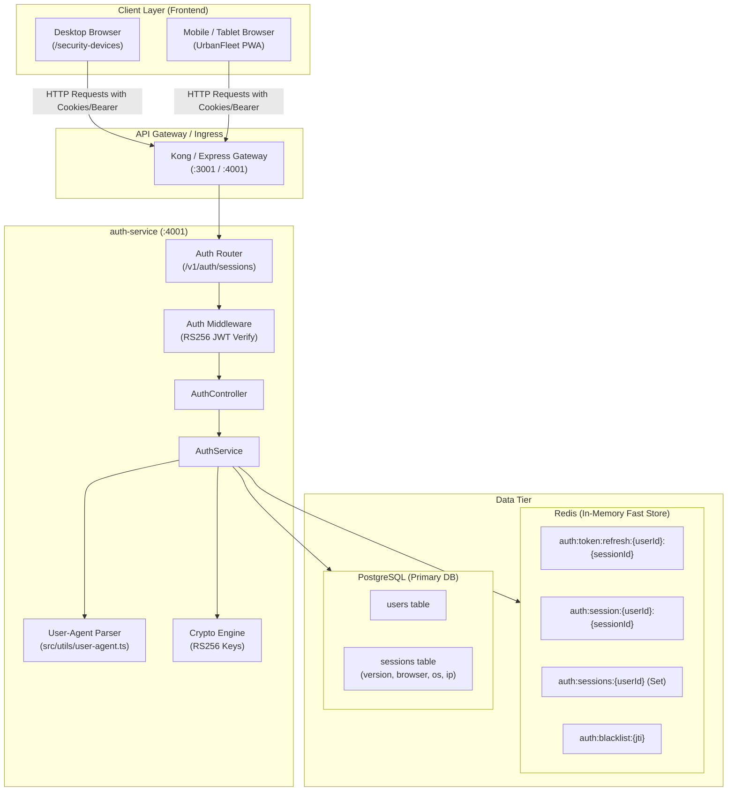
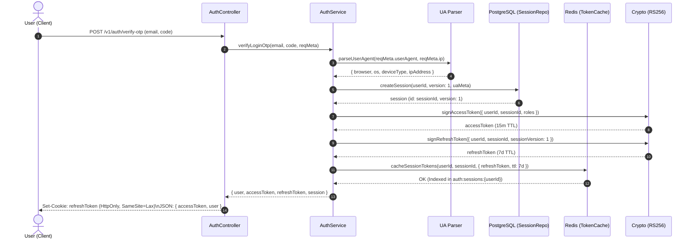
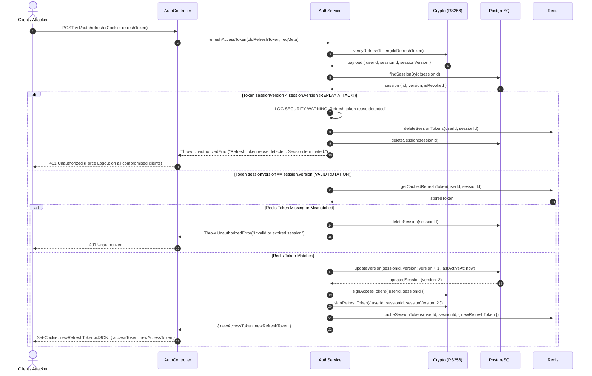
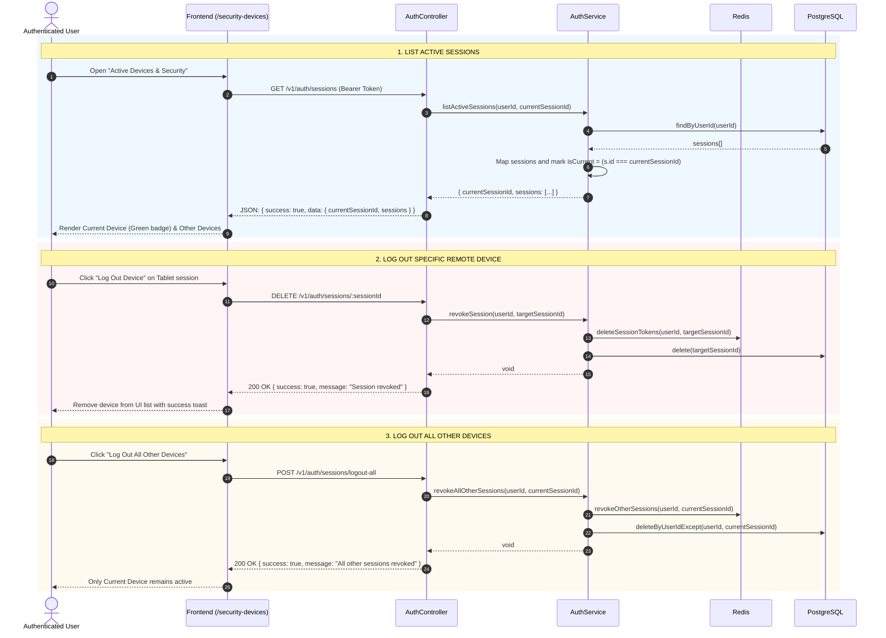

# UrbanFleet Session Management & Session Versioning Architecture

## 1. Executive Summary & Core Architectural Decisions

UrbanFleet's authentication and authorization tier implements a distributed **Session-Level Versioning and Multi-Device Management** architecture compliant with **RFC 6819 (OAuth 2.0 Threat Model and Security Considerations, Section 5.2.2.3)**.

### Key Architectural Decisions

1. **Purge of Legacy Admin & Audit Log**:
   - Complete removal of administrative controllers, routes, models, and enums from all microservices to prepare for a standalone, decoupled admin microservice in future iterations.
   - Complete removal of the legacy `AuditLog` model to simplify database schemas and eliminate write amplification.

2. **Session-Level Versioning (vs Global Token Versioning)**:
   - Instead of a monolithic `User.tokenVersion` which invalidates *all* devices whenever a user refreshes their token on a single phone or laptop, UrbanFleet implements **Session-Level Versioning** (`Session.version: Int`).
   - Each client login generates a unique `sessionId` (UUID). The session maintains its own monotonic counter (`version: 1, 2, 3...`).
   - Token rotation increments only that specific session's version, guaranteeing seamless multi-device coexistence without cross-device session disruption.

3. **100% Refresh Tokens in Redis (Zero Database Token Persistence)**:
   - Refresh tokens are **never** stored in PostgreSQL.
   - Stored strictly in Redis: `auth:token:refresh:${userId}:${sessionId}` with an active TTL matching refresh token expiration (7 days).
   - Eliminates database write amplification on every token rotation.
   - Guarantees zero credential exposure in PostgreSQL database backups and replication dumps.

4. **RFC 6819 Replay Attack & Token Reuse Detection**:
   - Refresh tokens are cryptographically signed with RS256 and encode:
     ```json
     {
       "userId": "uuid",
       "sessionId": "uuid",
       "sessionVersion": 1,
       "tokenType": "REFRESH"
     }
     ```
   - When a refresh token is presented:
     - If `token.sessionVersion === session.version`: Valid rotation. The version is incremented (`version + 1`), new tokens are issued, and old tokens replaced in Redis.
     - If `token.sessionVersion < session.version`: **Replay Attack Detected!** The presented token has already been rotated. The session is immediately revoked across Redis and PostgreSQL, terminating the compromised session instantly.

5. **Client Device Telemetry & Zero-Dependency Parsing**:
   - Zero external dependency parser (`src/utils/user-agent.ts`) analyzes the `User-Agent` and client IP headers (`x-forwarded-for`, `req.ip`).
   - Classifies device into clean human-readable descriptors: `deviceType` (`Desktop` | `Mobile` | `Tablet` | `Unknown`), `browser` (Chrome, Safari, Firefox, Edge, etc.), `os` (iOS, Android, macOS, Windows, Linux).
   - Stored in the database `Session` record and updated upon refresh.

---

## 2. High-Level System Architecture Diagram



---

## 3. Core Authentication Flows & Sequence Diagrams

### 3.1 Login & Session Creation Flow



---

### 3.2 Token Refresh & RFC 6819 Anti-Replay Detection



---

### 3.3 Multi-Device Session Management Flows



---

## 4. Data Models & Redis Key Schemas

### 4.1 PostgreSQL Schema (`prisma/schema.prisma`)

```prisma
model User {
  id              String        @id @default(uuid()) @db.Uuid
  email           String        @unique @db.VarChar(255)
  phoneNumber     String?       @unique @map("phone_number") @db.VarChar(20)
  passwordHash    String?       @map("password_hash") @db.VarChar(255)
  firstName       String        @map("first_name") @db.VarChar(100)
  lastName        String        @map("last_name") @db.VarChar(100)
  roles           UserRole[]    @default([RIDER])
  isEmailVerified Boolean       @default(false) @map("is_email_verified")
  createdAt       DateTime      @default(now()) @map("created_at")
  updatedAt       DateTime      @updatedAt @map("updated_at")

  sessions        Session[]

  @@map("users")
}

model Session {
  id           String    @id @default(uuid()) @db.Uuid
  userId       String    @map("user_id") @db.Uuid
  version      Int       @default(1)
  deviceType   String?   @map("device_type") @db.VarChar(50)
  browser      String?   @db.VarChar(100)
  os           String?   @db.VarChar(100)
  ipAddress    String?   @map("ip_address") @db.VarChar(45)
  userAgent    String?   @map("user_agent") @db.Text
  lastActiveAt DateTime  @default(now()) @map("last_active_at")
  expiresAt    DateTime  @map("expires_at")
  createdAt    DateTime  @default(now()) @map("created_at")
  updatedAt    DateTime  @updatedAt @map("updated_at")

  user         User      @relation(fields: [userId], references: [id], onDelete: Cascade)

  @@index([userId])
  @@map("sessions")
}
```

### 4.2 Redis Cache Key Namespace

| Key Pattern | Data Structure | TTL | Description |
| :--- | :--- | :--- | :--- |
| `auth:token:refresh:${userId}:${sessionId}` | String | 7 days (604,800s) | The current valid refresh token for the session. |
| `auth:sessions:${userId}` | Set | 7 days | Set of active `sessionId` strings for the user. Enables fast multi-device batch revocation. |
| `auth:session:${userId}:${sessionId}` | String (JSON) | 7 days | Serialized session metadata for rapid cache reads. |
| `auth:blacklist:${jti}` | String | 15 mins (900s) | Revoked access token identifier until natural JWT expiration. |

---

## 5. API Endpoints Reference

### 1. `GET /v1/auth/sessions`
- **Description**: Returns all active login sessions for the currently authenticated user.
- **Headers**: `Authorization: Bearer <accessToken>`
- **Response `200 OK`**:
```json
{
  "success": true,
  "data": {
    "currentSessionId": "c378e907-2c93-4a65-8b5d-2b47ea5b91b2",
    "sessions": [
      {
        "id": "c378e907-2c93-4a65-8b5d-2b47ea5b91b2",
        "browser": "Chrome 122.0",
        "os": "Windows 11",
        "deviceType": "Desktop",
        "ipAddress": "127.0.0.1",
        "lastActiveAt": "2026-10-25T02:40:00.000Z",
        "createdAt": "2026-10-25T01:30:00.000Z",
        "isCurrent": true
      },
      {
        "id": "8a0926a4-80a0-4bc6-8aa5-8be22c0d6c2d",
        "browser": "Mobile Safari",
        "os": "iOS 17.4",
        "deviceType": "Mobile",
        "ipAddress": "192.168.1.45",
        "lastActiveAt": "2026-10-24T18:15:00.000Z",
        "createdAt": "2026-10-24T10:00:00.000Z",
        "isCurrent": false
      }
    ]
  }
}
```

### 2. `DELETE /v1/auth/sessions/:id`
- **Description**: Revokes a specific session remotely (e.g., a lost or public device).
- **Headers**: `Authorization: Bearer <accessToken>`
- **Response `200 OK`**:
```json
{
  "success": true,
  "message": "Session revoked successfully."
}
```

### 3. `POST /v1/auth/sessions/logout-all`
- **Description**: Revokes all sessions belonging to the user **except** the current session making the request.
- **Headers**: `Authorization: Bearer <accessToken>`
- **Response `200 OK`**:
```json
{
  "success": true,
  "message": "All other sessions revoked successfully."
}
```

### 4. `POST /v1/auth/refresh`
- **Description**: Rotates the session refresh token and issues a new access token.
- **Cookies**: `refreshToken=<jwt>` (HttpOnly, SameSite=Lax, Secure in production)
- **Response `200 OK`**:
```json
{
  "success": true,
  "accessToken": "eyJhbGciOiJSUzI1NiIs..."
}
```

---

## 6. Frontend Implementation & User Experience

### 6.1 UI Component Architecture (`frontend/src/ActiveSessions.tsx`)
- **Visual Design**: Follows UrbanFleet's warm parchment/brass aesthetic (`#f5e6c8`, `#3a1f0a`, `#7a4416`, `#c58a3a`).
- **Dynamic Device Indicators**:
  - `Desktop`: `<Laptop />` icon with browser & OS badges.
  - `Mobile`: `<Smartphone />` icon.
  - `Tablet`: `<Tablet />` icon.
- **Current Device Visuals**: Highlighted in emerald tones (`border-emerald-600/40`, `bg-emerald-50/50`) with an active green pulsing status badge.
- **Relative Time Formatter**: Formats `lastActiveAt` dynamically ("Just now", "15m ago", "2h ago", "3d ago").
- **Safety Modal**: Interactive confirmation modal built with Framer Motion prevents accidental remote logouts.
- **Resilient Fallback**: Refresh button to re-sync device sessions without reloading the whole page.

### 6.2 Routes & Navigation
- Mounted route: `/security-devices` and `/sessions` in `frontend/src/main.tsx` inside protected rider and driver route wrappers.
- Navigation access:
  - **NavBar**: Added a "Devices" quick-access button in desktop header and mobile drawer.
  - **Rider Dashboard (`/dashboard`)**: Added a `<ShieldCheck />` button directly in the main header ticket.
  - **Driver Console (`/driver-dashboard`)**: Added a `<ShieldCheck />` button in the driver quick-actions bar.

---

## 7. Security & Threat Mitigation Matrix

| Security Threat | Threat Vector | UrbanFleet Architectural Mitigation | Standard / Rule |
| :--- | :--- | :--- | :--- |
| **Refresh Token Theft & Replay** | Attacker intercepts a rotated refresh token from transit or storage. | Session versioning detects `tokenVersion < session.version` on replay and immediately revokes the session in both Redis and DB. | **RFC 6819 Section 5.2.2.3** |
| **Database Compromise Credential Leak** | Attacker gets read-only access to PostgreSQL backup dump. | Zero refresh tokens exist in PostgreSQL. Only active, transient tokens live in Redis memory with strict 7-day TTL. | Defense-in-depth credential isolation |
| **Cross-Device Session Invalidation Frustration** | User refreshes token on laptop, causing phone app to unexpectedly log out. | Monotonic versioning is scoped strictly to `Session.version`, keeping each device isolated and alive independently. | Session-level Granularity |
| **Zombie Refresh Tokens** | Tokens remain valid after user changes password or logs out. | User logout or password reset wipes all keys in `auth:sessions:${userId}` and deletes sessions from DB. | Immediate Redis Set Invalidation |
| **Cross-Site Request Forgery (CSRF)** | Malicious third-party website triggers state-changing authenticated requests. | Custom CSRF token cookie paired with `x-csrf-token` header validation on all state-changing endpoints (`POST`, `PUT`, `DELETE`). | Double-Submit Cookie / Synchronizer Token |

---

## 8. Verification & Test Suite Results

The implementation was validated against the entire UrbanFleet test suite:
- **Unit & Integration Test Suites**: `services/auth-service/test/auth.service.test.ts`, `services/auth-service/test/auth-fixes.test.ts`, `services/auth-service/test/auth-flow.test.ts`.
- **Monorepo Test Suite Run**:
  ```
  Test Files  45 passed (45)
       Tests  449 passed (449)
    Duration  7.47s
  ```
- **Frontend Vite Production Build**:
  ```
  dist/assets/ActiveSessions-mI5rXxlG.js   17.01 kB │ gzip: 4.39 kB
  ✓ built in 1.70s with 0 errors
  ```
