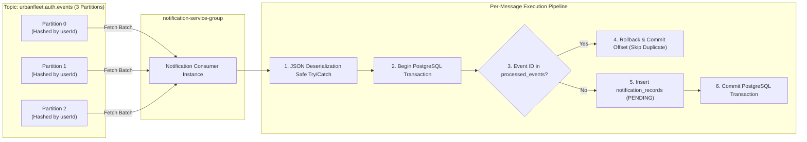
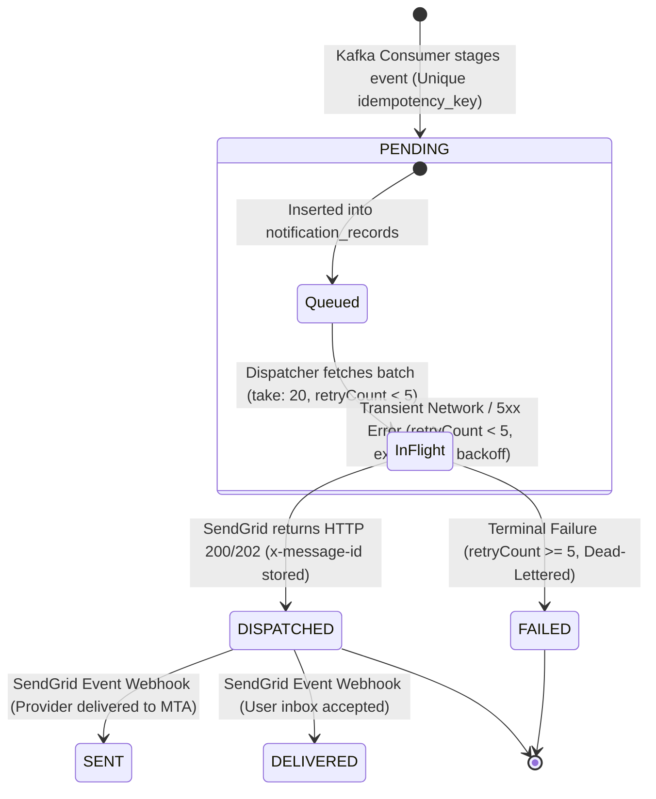
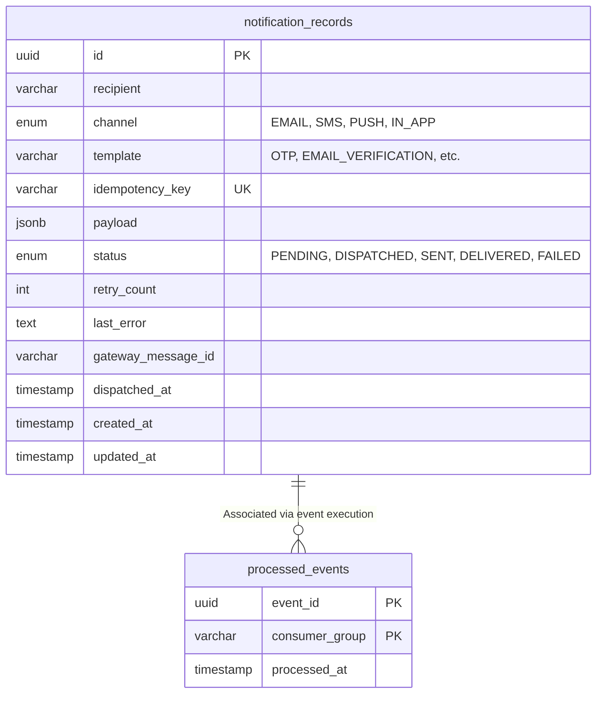
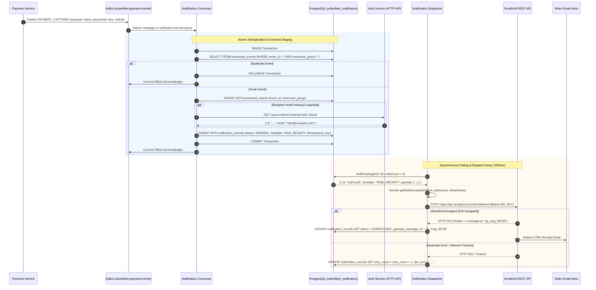
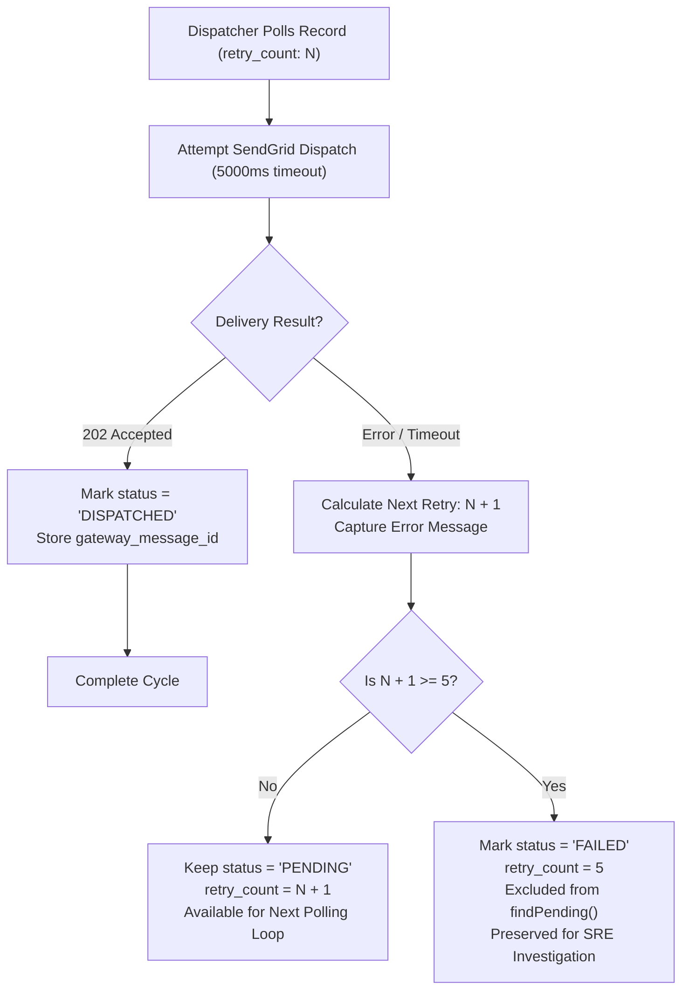

# 📬 UrbanFleet Notification Microservice
## Production System Design & Architectural Specification Manual

---

## 📑 Table of Contents
1. [Executive Summary & Problem Statement](#1-executive-summary--problem-statement)
2. [Core System Design Concepts & Architectural Decisions](#2-core-system-design-concepts--architectural-decisions)
   - [2.1 Temporal Decoupling & Fault Isolation](#21-temporal-decoupling--fault-isolation)
   - [2.2 Messaging Semantics: Achieving Effectively-Once Delivery](#22-messaging-semantics-achieving-effectively-once-delivery)
   - [2.3 The Transactional Inbox Pattern](#23-the-transactional-inbox-pattern)
   - [2.4 Bounded Queue Polling vs. Push Workers](#24-bounded-queue-polling-vs-push-workers)
   - [2.5 Asymmetric Zero-Trust Security (RS256)](#25-asymmetric-zero-trust-security-rs256)
3. [Visual Architecture Topologies (Mermaid)](#3-visual-architecture-topologies-mermaid)
   - [3.1 End-to-End Macro Architecture](#31-end-to-end-macro-architecture)
   - [3.2 Kafka Partitioning & Ingestion Flow](#32-kafka-partitioning--ingestion-flow)
   - [3.3 Notification Lifecycle State Machine](#33-notification-lifecycle-state-machine)
   - [3.4 Database Entity-Relationship Diagram](#34-database-entity-relationship-diagram)
   - [3.5 Payment Captured to Ride Receipt Sequence](#35-payment-captured-to-ride-receipt-sequence)
   - [3.6 Failure, Backoff & Dead-Lettering Flow](#36-failure-backoff--dead-lettering-flow)
4. [Component Architecture & Deep Code Anatomy](#4-component-architecture--deep-code-anatomy)
   - [4.1 Kafka Event Consumer Subsystem](#41-kafka-event-consumer-subsystem)
   - [4.2 Dispatcher Background Polling Worker](#42-dispatcher-background-polling-worker)
   - [4.3 Persistence & Repository Layer](#43-persistence--repository-layer)
   - [4.4 Responsive Email Template Engine](#44-responsive-email-template-engine)
   - [4.5 Strict Auth Middleware & Session Cache](#45-strict-auth-middleware--session-cache)
   - [4.6 REST API & IDOR Security Engine](#46-rest-api--idor-security-engine)
5. [Granular Edge Case Handling & Failure Mode Engineering](#5-granular-edge-case-handling--failure-mode-engineering)
6. [Implementation Status Matrix](#6-implementation-status-matrix)
7. [Operational Runbook & Verification](#7-operational-runbook--verification)

---

## 1. Executive Summary & Problem Statement

In a distributed ride-hailing architecture like UrbanFleet, customer actions (e.g. signing up, requesting login OTPs, resetting passwords, and completing rides) trigger critical notifications. 

### Why a Dedicated Notification Microservice?
If individual microservices (`auth-service`, `payment-service`, `ride-service`) directly made synchronous HTTP calls to an external email provider (SendGrid):
1. **Network Latency & Thread Blocking**: SendGrid API calls take 200ms–2000ms. If `auth-service` waits for an email to send before returning an HTTP response to a user registering or logging in, API throughput drops drastically, and connection pools deplete.
2. **Cascading Failures**: If SendGrid experiences downtime, latency spikes, or HTTP 500 errors, user registration, OTP generation, and ride checkouts would fail entirely.
3. **Data Loss on Pod Restarts**: If an application crashes mid-request, transient notification data in memory is lost forever.
4. **Third-Party Rate Limits**: Upstream providers enforce strict rate limits (e.g. 100 requests/second). Uncontrolled burst traffic during rush hours causes massive 429 Too Many Requests drops.

**UrbanFleet Notification Service** solves this by acting as an **asynchronous, durable, fault-tolerant message hub**. It decouples event emission from external delivery via Kafka and an ACID PostgreSQL database.

---

## 2. Core System Design Concepts & Architectural Decisions

### 2.1 Temporal Decoupling & Fault Isolation
- **Temporal Decoupling**: The producer (e.g. `payment-service`) does not need to know *when* or *how* the email is sent. It simply writes an event to Kafka. The Notification Service consumes it asynchronously at its own pace.
- **Fault Isolation**: If SendGrid is down for 3 hours, UrbanFleet riders can still register, login with OTP, book rides, and pay. The notifications are safely staged in PostgreSQL (`status: PENDING`) and dispatched automatically the moment SendGrid recovers.

### 2.2 Messaging Semantics: Achieving Effectively-Once Delivery
In distributed systems, networks are unreliable. Kafka guarantees **At-Least-Once** delivery by default. Under network partitions or consumer rebalancing, Kafka may deliver the exact same event envelope multiple times.

To prevent sending a rider multiple identical receipts or duplicate OTP codes, the Notification Service achieves **Effectively-Once (Idempotent) Delivery** using a **two-tier deduplication barrier**:
1. **Event Deduplication Barrier (`processed_events`)**: A relational table storing `(event_id, consumer_group)`. When Kafka delivers a message, an atomic check-and-insert is performed inside a PostgreSQL transaction (`prisma.$transaction`). If `event_id` already exists for `notification-service-group`, the message is discarded immediately.
2. **Business Key Idempotency Barrier (`notification_records.idempotency_key`)**: The table enforces a `@unique` constraint on a deterministic business key (e.g. `receipt_${rideId}_${paymentId}`). Even if two concurrent workers attempt to stage the same receipt, the unique constraint causes a database collision, rejecting duplicates.

```
+-------------------------------------------------------------------------+
|                  EFFECTIVELY-ONCE DEDUPLICATION BARRIER                 |
|                                                                         |
|  Incoming Kafka Envelope                                                |
|  ID: 8fa7b2c1-....                                                      |
|           │                                                             |
|           ▼                                                             |
|  [ Barrier 1: processed_events (event_id, consumer_group) ]             |
|       ├─ Exists? ───► YES ───► Discard silently (Commit Offset)         |
|       └─ No  ───────► INSERT & Proceed                                  |
|                            │                                            |
|                            ▼                                            |
|  [ Barrier 2: notification_records.idempotency_key ]                    |
|       ├─ Key: "receipt_ride_123_pay_456"                                |
|       ├─ Conflict? ─► Database Unique Constraint Rejection              |
|       └─ Success ───► Insert Staged Record (status: PENDING)            |
+-------------------------------------------------------------------------+
```

### 2.3 The Transactional Inbox Pattern
Rather than dispatching emails directly inside the Kafka message handler, UrbanFleet utilizes the **Transactional Inbox Pattern**:
- The Kafka consumer writes the notification to `notification_records` with `status: 'PENDING'`.
- A separate, asynchronous worker (`NotificationDispatcher`) polls this table and dispatches emails.
- **Advantage**: The Kafka consumer commits offsets in milliseconds without waiting for third-party network I/O. If SendGrid takes 5 seconds to reply, it does not block the Kafka partition consumer lag.

### 2.4 Bounded Queue Polling vs. Push Workers
Instead of unbounded querying or naive in-memory queues that risk Out-Of-Memory (OOM) crashes:
- The `NotificationDispatcher` uses **bounded, batch polling** (`take: 20`).
- The query targets a composite B-Tree index: `@@index([status, created_at])`.
- The worker executes:
  ```sql
  SELECT * FROM notification_records 
  WHERE status = 'PENDING' AND retry_count < 5 
  ORDER BY created_at ASC 
  LIMIT 20;
  ```
- This guarantees constant-time query complexity ($O(\log N)$) regardless of whether the table contains 100 rows or 10,000,000 rows.

### 2.5 Asymmetric Zero-Trust Security (RS256)
- The Notification Service does not share a secret symmetric key (like HMAC SHA256) with other services.
- The `auth-service` holds a **2048-bit RSA Private Key** to sign tokens.
- All downstream services, including `notification-service`, only possess the public key (`JWT_PUBLIC_KEY_BASE64`).
- Even if the Notification Service or database were completely compromised, attackers cannot forge authentication tokens for other services.

---

## 3. Visual Architecture Topologies (Mermaid)

### 3.1 End-to-End Macro Architecture

```mermaid
flowchart TD
    subgraph Producers ["Microservice Event Producers"]
        AUTH["Auth Service<br/>• USER_LOGIN_OTP_REQUESTED<br/>• USER_EMAIL_VERIFICATION_REQUESTED<br/>• USER_PASSWORD_RESET_REQUESTED"]
        PAY["Payment Service<br/>• PAYMENT_CAPTURED"]
    end

    subgraph Kafka ["Apache Kafka Cluster (KRaft Mode)"]
        TOPIC_AUTH[("urbanfleet.auth.events")]
        TOPIC_PAY[("urbanfleet.payment.events")]
    end

    AUTH -->|Publish Envelope| TOPIC_AUTH
    PAY -->|Publish Envelope| TOPIC_PAY

    subgraph Service ["UrbanFleet Notification Service (Port 4003)"]
        subgraph IngestionLayer ["Ingestion Subsystem"]
            CONSUMER["Kafka Consumer<br/>(groupId: notification-service-group)"]
        end

        subgraph StorageLayer ["PostgreSQL Database (urbanfleet_notification)"]
            PE[("processed_events Table<br/>PK: event_id + consumer_group")]
            NR[("notification_records Table<br/>Status: PENDING, DISPATCHED, FAILED<br/>Index: status, created_at")]
        end

        subgraph WorkerLayer ["Dispatch Engine"]
            DISPATCHER["Notification Dispatcher Worker<br/>• Polling Loop (every 2s)<br/>• Batch Size: 20<br/>• Max Retries: 5"]
            TEMPLATES["Template Engine<br/>• getOtpHtml()<br/>• getVerifyEmailHtml()<br/>• getResetPasswordHtml()<br/>• getRideReceiptHtml()"]
        end

        subgraph IngressLayer ["API & Security Subsystem"]
            AUTH_MW["RS256 Auth Middleware<br/>• Session validation (Redis)<br/>• User cache (Redis)<br/>• AuthClient DB fallback"]
            ROUTER["Express REST Router<br/>• GET /health<br/>• GET /my<br/>• GET /:id (IDOR Protection)"]
        end
    end

    TOPIC_AUTH -->|Consume| CONSUMER
    TOPIC_PAY -->|Consume| CONSUMER

    CONSUMER -->|1. Check & Insert Event ID| PE
    CONSUMER -->|2. Stage Notification| NR

    DISPATCHER -->|3. Poll PENDING FIFO| NR
    DISPATCHER -->|4. Compile HTML| TEMPLATES
    DISPATCHER -->|5. HTTP POST /v3/mail/send| SENDGRID["SendGrid Cloud API"]
    SENDGRID -->|6. Return x-message-id| DISPATCHER
    DISPATCHER -->|7. Mark DISPATCHED| NR

    CLIENT["Mobile / Web Frontend"] -->|HTTPS via Kong (Port 3001)| AUTH_MW
    AUTH_MW --> ROUTER
    ROUTER -->|Read Notifications| NR
```

---

### 3.2 Kafka Partitioning & Ingestion Flow



---

### 3.3 Notification Lifecycle State Machine



---

### 3.4 Database Entity-Relationship Diagram



---

### 3.5 Payment Captured to Ride Receipt Sequence



---

### 3.6 Failure, Backoff & Dead-Lettering Flow



---

## 4. Component Architecture & Deep Code Anatomy

### 4.1 Kafka Event Consumer Subsystem
- **File**: [`services/notification-service/src/consumers/notification.consumer.ts`](file:///C:/Users/aksha/OneDrive/Desktop/urbanfleet-project/services/notification-service/src/consumers/notification.consumer.ts)
- **Role**: Durable, non-blocking ingestion engine.
- **Consumer Group**: `notification-service-group`.
- **Key Methods**:
  - `initNotificationConsumer(prisma, notifService)`: Connects client, subscribes to `EventTopics.AUTH_EVENTS` and `EventTopics.PAYMENT_EVENTS`.
  - `eachMessage`:
    - Safely parses incoming JSON buffer.
    - Executes atomic deduplication against `processed_events`.
    - Dispatches to specialized handlers:
      - `USER_LOGIN_OTP_REQUESTED`: Stages `OTP` notification.
      - `USER_EMAIL_VERIFICATION_REQUESTED`: Stages `EMAIL_VERIFICATION` notification.
      - `USER_PASSWORD_RESET_REQUESTED`: Stages `PASSWORD_RESET` notification.
      - `USER_REGISTERED`: Verifies presence of `verifyToken` before staging.
      - `PAYMENT_CAPTURED`: Queries `authClient` if `email` is absent, then stages `RIDE_RECEIPT`.

### 4.2 Dispatcher Background Polling Worker
- **File**: [`services/notification-service/src/workers/notification.dispatcher.ts`](file:///C:/Users/aksha/OneDrive/Desktop/urbanfleet-project/services/notification-service/src/workers/notification.dispatcher.ts)
- **Role**: Asynchronous delivery processor running in a detached loop.
- **Key Methods**:
  - `start()` / `stop()`: Lifecycle controls enabling clean startup and graceful shutdown.
  - `runLoop()`: Infinite async loop executing every 2000ms (`setTimeout(2000)`).
  - Dynamic Compilation: Inspects `item.template` and dynamically passes parameters into HTML generators:
    - `item.template === 'OTP'` $\rightarrow$ `getOtpHtml({ email, otp })`
    - `item.template === 'EMAIL_VERIFICATION'` $\rightarrow$ `getVerifyEmailHtml({ email, token })`
    - `item.template === 'PASSWORD_RESET'` $\rightarrow$ `getResetPasswordHtml({ email, token })`
    - `item.template === 'RIDE_RECEIPT'` $\rightarrow$ `getRideReceiptHtml({ ... })`
  - Upstream Header Inspection: Reads `response.headers['x-message-id']` and stores it into `gateway_message_id`.

### 4.3 Persistence & Repository Layer
- **Files**:
  - Schema: [`services/notification-service/prisma/schema.prisma`](file:///C:/Users/aksha/OneDrive/Desktop/urbanfleet-project/services/notification-service/prisma/schema.prisma)
  - Repository: [`services/notification-service/src/repositories/notification.repository.ts`](file:///C:/Users/aksha/OneDrive/Desktop/urbanfleet-project/services/notification-service/src/repositories/notification.repository.ts)
- **Database**: PostgreSQL 15 (`urbanfleet_notification`).
- **Key Queries**:
  - `findPending(limit = 20)`: Bounded query ordering by `createdAt: 'asc'` filtering `status: 'PENDING'` and `retryCount: { lt: 5 }`.
  - `markDispatched(id, gatewayMessageId)`: Sets `status = 'DISPATCHED'`, stores message ID, updates `dispatchedAt = new Date()`.
  - `recordFailure(id, error)`: Increments `retryCount`. If `nextRetry >= 5`, automatically transitions status to `FAILED`.
  - `findByRecipients(recipients, limit = 50)`: Optimized multi-recipient lookup supporting combined email and `userId` queries.

### 4.4 Responsive Email Template Engine
- **File**: [`services/notification-service/src/services/email.service.ts`](file:///C:/Users/aksha/OneDrive/Desktop/urbanfleet-project/services/notification-service/src/services/email.service.ts)
- **Design Philosophy**: Inline CSS styling (`baseStyles`), bulletproof table-based layouts, high contrast (`#111827`), mobile responsiveness, and email client compatibility (Outlook, Apple Mail, Gmail).
- **Templates**:
  1. **OTP Email**: Prominent 32px letter-spaced monospace verification code box with a 5-minute expiry alert.
  2. **Email Verification**: Single high-contrast CTA button directing to `${FRONTEND_URL}/verify-email?token=...` with plain-text URL fallback for non-HTML mail readers.
  3. **Password Reset**: Security-hardened reset link with advisory warning to ignore if not requested by the user.
  4. **Ride Receipt**: Complete financial itemization: Base fare, Surge, Platform fee, GST, and Total fare in Indian Rupees (₹), coupled with pickup/dropoff addresses and driver details.

### 4.5 Strict Auth Middleware & Session Cache
- **File**: [`services/notification-service/src/middlewares/auth.middleware.ts`](file:///C:/Users/aksha/OneDrive/Desktop/urbanfleet-project/services/notification-service/src/middlewares/auth.middleware.ts)
- **Role**: Zero-trust API protection.
- **Steps**:
  1. Extracts Bearer token from `Authorization` header or HTTP-only cookies.
  2. Cryptographically verifies RS256 signature against `JWT_PUBLIC_KEY_BASE64` with strict audience (`urbanfleet-api`) and issuer (`urbanfleet-auth`).
  3. Validates session state concurrently in Redis (`auth:session:${sessionId}` and `auth:user-sessions:${userId}`).
  4. Checks Redis user cache (`auth:user:${userId}`). If cache miss occurs, falls back to `authClient.getUserById(userId)`.
  5. **Fail-Stop**: If the user does not exist in the database, throws `401 USER_NOT_FOUND`.
  6. **Network Resilience**: If AuthClient fails due to a network outage, throws `503 AUTH_SERVICE_UNAVAILABLE`.

### 4.6 REST API & IDOR Security Engine
- **File**: [`services/notification-service/src/routes/notification.routes.ts`](file:///C:/Users/aksha/OneDrive/Desktop/urbanfleet-project/services/notification-service/src/routes/notification.routes.ts)
- **Routes**:
  - `GET /health`: Multi-dependency health check reporting status of PostgreSQL database, Dispatcher worker loop, and Kafka Consumer readiness.
  - `GET /my`: Queries notifications for `req.user.email` and `req.userId`.
  - `GET /:id`: Retrieves single notification with **Triple-Layer Ownership Verification**:
    ```ts
    const isOwner =
      Boolean(userEmail && record.recipient.toLowerCase() === userEmail.toLowerCase()) ||
      Boolean(userId && record.recipient === userId) ||
      Boolean(userId && payload && (
        payload.userId === userId ||
        payload.riderId === userId ||
        payload.driverId === userId
      ));

    if (!isPrivileged && !isOwner) {
      return res.status(403).json({ code: 'FORBIDDEN', message: 'You are not authorized to view this notification' });
    }
    ```

---

## 5. Granular Edge Case Handling & Failure Mode Engineering

```
+--------------------------------------------------------------------------------------------------------------------------+
|                                    URBANFLEET GRANULAR EDGE CASE MATRIX                                                 |
+----+--------------------------------+--------------------------------------+---------------------------------------------+
| #  | Scenario                       | Failure Risk                         | Engineering Solution in Codebase            |
+----+--------------------------------+--------------------------------------+---------------------------------------------+
| 1  | Kafka Message Redelivery       | User receives duplicate emails/OTPs. | Atomic transaction check in                 |
|    | (At-Least-Once Replay)         |                                      | processed_events (eventId + consumerGroup)  |
+----+--------------------------------+--------------------------------------+---------------------------------------------+
| 2  | SendGrid API Down (5xx / 504)  | Worker loop crashes; delivery stalls.| Axios timeout (5000ms); try/catch logs      |
|    |                                |                                      | failure, increments retryCount, non-blocking|
+----+--------------------------------+--------------------------------------+---------------------------------------------+
| 3  | Upstream Rate Limit (HTTP 429) | Mass drops during traffic spikes.    | Staged status remains PENDING; retried      |
|    |                                |                                      | gracefully in subsequent batch iterations   |
+----+--------------------------------+--------------------------------------+---------------------------------------------+
| 4  | Poison Pill Message            | Consumer crashes in an infinite loop;| Safe try/catch around JSON.parse; logs      |
|    | (Malformed JSON in Topic)      | partition gets blocked.              | structured error and advances Kafka offset  |
+----+--------------------------------+--------------------------------------+---------------------------------------------+
| 5  | Missing Email in Payment Event | Ride receipt cannot be addressed.    | Dynamic lookup via authClient.getUserById;  |
|    |                                |                                      | skips staging cleanly if email unresolvable |
+----+--------------------------------+--------------------------------------+---------------------------------------------+
| 6  | Permanent Bad Email Domain     | Failing record blocks queue forever. | Dead-Lettering: after retryCount >= 5,      |
|    |                                |                                      | record marked FAILED and excluded from loop |
+----+--------------------------------+--------------------------------------+---------------------------------------------+
| 7  | Insecure Direct Object Query   | Malicious user reads other receipts  | Multi-dimensional ownership check against   |
|    | (IDOR on GET /:id)             | via guessable UUIDs.                 | recipient, payload IDs, and ADMIN role      |
+----+--------------------------------+--------------------------------------+---------------------------------------------+
| 8  | Deactivated / Deleted Account  | User with valid JWT accesses data.   | Auth middleware queries DB via AuthClient;  |
|    |                                |                                      | rejects missing users with 401 Unauthorized |
+----+--------------------------------+--------------------------------------+---------------------------------------------+
| 9  | Auth Service Network Partition | HTTP API hangs on token check.       | Middleware catches connection drop, returns |
|    |                                |                                      | 503 AUTH_SERVICE_UNAVAILABLE                |
+----+--------------------------------+--------------------------------------+---------------------------------------------+
| 10 | BigInt Fare Serialization      | JSON serializer throws TypeError     | Explicit Number(payload.totalFarePaise || 0)|
|    |                                | during receipt HTML generation.      | conversion before template formatting       |
+----+--------------------------------+--------------------------------------+---------------------------------------------+
| 11 | Container SIGTERM / SIGINT     | Corrupted Kafka offset or DB leak    | Orderly hook: dispatcher.stop() -> close()  |
|    |                                | during container shutdown.           | -> consumer.disconnect() -> $disconnect()   |
+----+--------------------------------+--------------------------------------+---------------------------------------------+
| 12 | DB Connection Starvation       | High volume exhausted pool.          | Parameterized Prisma queries with bounded   |
|    |                                |                                      | batch sizes (take: 20) and pooled connection|
+----+--------------------------------+--------------------------------------+---------------------------------------------+
```

---

## 6. Implementation Status Matrix

| Component | Subsystem | Code Status | Verified in Test Suite |
| :--- | :--- | :---: | :---: |
| **Kafka Event Consumer** | Ingestion | **100% Implemented** | `test/notification-fixes.test.ts` |
| **Transactional Deduplication** | Reliability | **100% Implemented** | `test/notification-fixes.test.ts` |
| **PostgreSQL Schema & Migrations**| Persistence | **100% Implemented** | Prisma Engine verified |
| **Dispatcher Background Worker** | Delivery Engine | **100% Implemented** | `test/notification.service.test.ts` |
| **SendGrid v3 Email Driver** | External Delivery | **100% Implemented** | `test/notification-fixes.test.ts` |
| **Responsive HTML Templates** | Presentation | **100% Implemented** | `test/notification.service.test.ts` |
| **REST Routing & IDOR Prevention** | API Security | **100% Implemented** | `test/notification-fixes.test.ts` |
| **RS256 JWT & Session Middleware** | Authentication | **100% Implemented** | `test/auth.middleware.test.ts` |
| **Containerization & Health Checks**| Infrastructure | **100% Implemented** | Docker Desktop Build verified |
| **SMS Gateway Driver (Twilio/SNS)**| Channel Expansion | ⏳ *Schema Defined* | Planned Scope |
| **Push Gateway Driver (FCM)** | Channel Expansion | ⏳ *Schema Defined* | Planned Scope |
| **SendGrid Delivery Webhook** | Status Callbacks | ⏳ *Schema Defined* | Planned Scope |

---

## 7. Operational Runbook & Verification

### Running the Test Suite
```bash
# Execute Notification Service tests
npx vitest run services/notification-service

# Execute with test coverage
npx vitest run services/notification-service --coverage
```

### Typecheck Verification
```bash
npm run typecheck --workspace=@urbanfleet/notification-service
```

### Local Development Lifecycle
```bash
# 1. Start core data infrastructure (Postgres, Redis, Kafka)
npm run docker:infra

# 2. Synchronize Prisma Schema
npm run prisma:generate --workspace=@urbanfleet/notification-service
npm run prisma:migrate --workspace=@urbanfleet/notification-service

# 3. Start Notification Service with hot-reloading
npm run dev:notification
```

### Docker Multi-Stage Build & Inspection
```bash
# Build standalone Docker image
docker build -f services/notification-service/Dockerfile -t urbanfleet-notification-service .

# Inspect installed Prisma binaries inside Alpine container
docker run --rm urbanfleet-notification-service npx prisma -v
```
